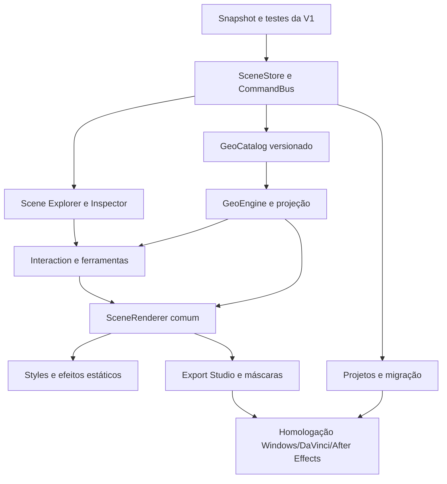
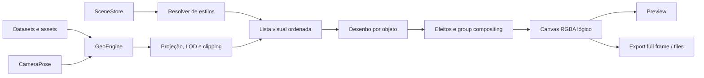

# CartoRig — Especificação Mestra de Produto e Implementação

**Documento:** CR-SPEC-2.0  
**Versão da especificação:** 1.0 · 13 de novembro de 2026  
**Produto-alvo:** CartoRig 2.0 — ferramenta de composição de cenas cartográficas  
**Base de código obrigatória:** Map Composer 1.0 original (Go + HTML/CSS/JavaScript + Canvas 2D)  
**Plataforma inicial:** Windows 10/11 x64  
**Idioma da interface do produto:** inglês; documentação de especificação: português  
**Licenciamento do código próprio:** MIT, sujeito à auditoria dos recursos de terceiros  
**Estado:** especificação de implementação; não representa funcionalidades já concluídas.

> **Decisão de escopo vinculante.** CartoRig cria **cenas cartográficas estáticas, personalizadas e exportáveis em camadas**. Animação e montagem são realizadas em DaVinci Resolve, Premiere Pro, After Effects ou outro editor. É proibido introduzir timeline, keyframes, Motion, Graph Editor, playback, editor de vídeo, gerenciamento de clipes ou render de sequência temporal neste produto. Não há migração obrigatória para Qt, Electron, Wails ou outro host. Preservar a base Go e o mecanismo de execução local existente.

---

## 0. Como utilizar esta especificação

Esta é uma especificação para implementação, não apenas um catálogo de ideias. Cada requisito deve orientar trabalho de produto, interface, backend, testes e revisão de código. **RF** designa requisito funcional; **RNF**, não funcional; **DAD**, contrato de dados; **EXP**, contrato de exportação; **AT**, cenário de aceitação. Os estados de entrega são *a implementar*, *implementado*, *testado* e *homologado*. Nenhuma feature pode ser declarada entregue apenas porque existe um controle visual.

**Critério de conclusão de qualquer RF:** (1) comportamento observável funciona; (2) estado persiste; (3) seleção/edição não altera objetos não relacionados; (4) exportação corresponde ao preview; (5) Undo/Redo acompanha operações mutáveis; (6) casos de erro são tratados; (7) testes automatizados e manuais correspondentes passam. Recursos não disponíveis devem permanecer invisíveis ou explicitamente desabilitados, nunca simulados.

### 0.1 Fontes de decisão

1. **Base constatada no código original:** `main.go`, `installer.go`, `assets/app.js`, `assets/index.html`, `assets/style.css`, `assets/countries.json`, arquivos raster, README e testes do Map Composer 1.0.
2. **Escopo aprovado nesta conversa:** Scene Explorer, geografia mais detalhada, Style Studio, Region Editor, Route Designer, Marker Studio, Typography Studio, Drawing & Annotation, câmera/enquadramento estático, Export Studio e gestão de projetos.
3. **Decisões de engenharia propostas aqui:** estruturas de dados, API, algoritmos, ordem de implementação, limites e critérios de aceitação. São propostas técnicas para executar o escopo, não fatos já presentes na versão 1.0.

### 0.2 Matriz de escopo

| Incluído | Não incluído |
|---|---|
| Editor visual 2D, camadas e grupos | Timeline, keyframes, Motion, Graph Editor |
| Objetos geográficos editáveis | Animação dentro do CartoRig |
| Relevo, texturas, cores e efeitos estáticos | Edição/montagem de vídeo |
| Câmera de **enquadramento estático** | Movimentos animados de câmera |
| Rotas e desenhos estáticos | Animação de rotas ou marcadores viajantes |
| Exportação PNG/SVG conforme capacidade e máscaras | Geração de vídeo, GIF ou sequência de frames temporais |
| Projetos e presets de composição | Dependência ou plugins obrigatórios de um editor específico |
| Operação offline | Serviços online compulsórios, tokens, telemetria obrigatória |

---

## 1. Diagnóstico reproduzível da base Map Composer 1.0

### 1.1 Inventário real

| Arquivo / comportamento | Situação verificada | Consequência |
|---|---|---|
| `main.go` | Go, `embed.FS`, HTTP em loopback, `/api/health`, `/api/bundle`, `/api/quit` | Reaproveitar host e empacotador, modularizar serviços |
| `installer.go` | Instalador Windows produzido pela própria base Go | Preservar estratégia de build e desinstalação; testar no Windows real |
| `assets/index.html` | Editor em três colunas, controles de pesquisa, mapa e estilo | Preservar disposição geral; substituir seções por módulos bem definidos |
| `assets/app.js` | Aplicação, estado, geometria, edição e exportação concentrados em ~213 linhas densas | Extrair módulos sem reescrever tudo de uma vez |
| `assets/countries.json` | 177 países da base simplificada Natural Earth 1:110m | Conservar como fallback e teste de regressão; ampliar por manifestos |
| `assets/*.jpg` | Três texturas base offline | Reaproveitar conforme licenças; oferecer LOD e tratamento de resolução |
| `state.highlights` | Lista de objetos `iso`, `color`, sem identidade global estável | Migrar para `Region` com UUID e estilo próprio |
| `state.routes` | Pares de pontos e uma cor | Migrar para `Route` com endpoints, geometria e aparência editáveis |
| `state.labels` | Texto, ponto, tamanho e cor | Migrar para `Label` com tipografia e vínculo geográfico |
| `state.layers` | Seis flags de grupos (`background/grid/borders/highlights/routes/labels`) | Criar Scene Graph e preservar flags migradas |
| `state.view` | `cx`, `cy`, `zoom` | Migrar para `CameraPose` estática; acrescentar `bearing` |
| `PALETTES` | Sete temas embutidos | Transformá-los em presets com overrides persistentes |
| Exportação | Canvas para PNG e POST multipart para ZIP | Reutilizar endpoint, evoluir para exportação por objeto e streaming |
| Persistência | Downloads JSON e `localStorage` por origem | Adotar `.cartorig` versionado e autosave no backend |

O código original gera o mapa com projeção equiretangular, desenha regiões vetoriais via Canvas 2D e exporta seis categorias de camadas mais a composição final. Ele **não** fornece os recursos 2.0 abaixo, ainda que alguns nomes de funcionalidade já apareçam na interface.

### 1.2 Regras de preservação

**RNF-BASE-001.** A evolução começa da árvore de código 1.0, não de uma aplicação nova desconectada.  
**RNF-BASE-002.** É obrigatório continuar abrindo e convertendo projetos `.mapcomposer.json` versão 1.  
**RNF-BASE-003.** A primeira etapa de desenvolvimento não poderá remover exportação PNG/ZIP, pesquisa de países, sete estilos, zoom e pan.  
**RNF-BASE-004.** Reestruturações internas devem ser acompanhadas por testes de equivalência visual entre a versão original e a nova, usando mesmas entradas e resolução.

---

## 2. Princípios, arquitetura e responsabilidades

### 2.1 Produto para compositores, não um GIS complexo

**Objetivo:** permitir que um criador de documentários produza rapidamente mapas com qualidade visual, sem lidar com shapefiles, CRS, cálculos geográficos ou montagem de layers técnicos. Informações de proveniência e precisão existem para confiança e diagnóstico, não para dominar a interface principal.

O fluxo-base deve seguir: **New/Open Project → Search/Add → Arrange → Style/Edit → Frame → Export**. O mapa deve ser útil antes de qualquer objeto editorial ser criado. O usuário não deve precisar abrir cinco diálogos para adicionar um país ou mudar sua cor.

### 2.2 Arquitetura física aprovada

```text
CartoRig.exe  (Go; Windows x64)
 ├── servidor HTTP local: 127.0.0.1, porta dinâmica segura
 ├── assets embarcados por embed.FS
 ├── API de projeto, catálogo, arquivos e exportação
 ├── cache/índice e leitura de geodados offline
 ├── serviço de salvamento e empacotamento ZIP
 └── abre frontend no navegador local existente
       ├── HTML/CSS e módulos JavaScript (TypeScript é migração opcional, incremental)
       ├── Scene Explorer / Geographic Search
       ├── Composition Viewer (Canvas 2D inicialmente)
       ├── Inspector contextual / Style Studio
       ├── SceneStore / CommandBus / UndoRedo
       ├── GeoRenderer / HitTest / Editor Tools
       └── Export Composer (mesmo pipeline de desenho)
```

Nenhuma tecnologia de host desktop é pré-requisito da versão 2.0. A aplicação mantém instalador e atalho Windows e executa localmente; frontend no navegador é comportamento conhecido da base, não uma lacuna funcional a ser resolvida com Electron/Wails. O backend continua acessível somente via loopback com autenticação de sessão e proteção contra chamadas de páginas externas (seção 20).

### 2.3 Módulos e fronteiras de responsabilidade

| Módulo | Responsabilidade | Restrições |
|---|---|---|
| `SceneStore` | Estado autoral serializável: árvores, estilos, câmera, assets | Não guarda objetos do DOM, contextos Canvas ou funções |
| `CommandBus` | Comandos transacionais, histórico, alterações consistentes | Nunca modificar o estado em eventos de UI diretamente |
| `SelectionService` | Seleção, multi-select, hit-test, seleção na árvore/viewer | Um conjunto de seleção único para toda a interface |
| `GeoCatalog` | Busca offline e metadados de feições | Não confundir feature com objeto autoral |
| `GeoEngine` | Geometrias, bounding boxes, projeção, clipping, distâncias e caminhos | WGS84, antimeridiano, zero inventos geográficos |
| `SceneRenderer` | Renderizar qualquer objeto em ordem e com alfa | Mesma implementação lógica de preview/export |
| `StyleResolver` | Tema → categoria → grupo → override → estilo efetivo | Trocar preset não destruir override explícito |
| `EditorTools` | Pan, select, region, route, marker, text, shape, handles | Sem alterar objetos quando não selecionados |
| `AssetManager` | Texturas, ícones, fontes, hashes e referências | Offline; avisar faltas/limitações de licença |
| `ExportService` | PNG, máscaras, SVG compatível, pacote por camada, manifesto | Exportação não muda o projeto |
| `ProjectService` | Save/Load, migração, autosave, recuperação, backups | Escrita atômica, versionamento e diagnósticos |
| `Diagnostics` | Erros, dados ausentes, qualidade e logs | Mensagens úteis, sem prometer sucesso não confirmado |

### 2.4 Mapa de dependência e ordem técnica



A arquitetura fica deliberadamente enxuta: evitar banco de dados remoto, estado duplicado Go/JS sem contrato, workers sem necessidade, framework de UI complexo ou dependências geográficas obrigatórias em tempo de execução.

---

## 3. Modelo autoral, IDs e persistência — fundação de todas as features

### 3.1 Objetos obrigatórios

**RF-SCENE-001 — Scene Graph independente.**  
**O que é:** árvore de objetos e grupos, em vez de seis flags globais e arrays sem hierarquia.  
**Para que serve:** permitir editar, reordenar, ocultar e exportar separadamente qualquer elemento.  
**Como implementar:** `SceneDocument` possui `scene.root_ids` ordenados, `objects` indexados por UUID, `parent_id` para grupos, `z_index` resolvido por travessia da árvore e um único objeto `WorldMap` estrutural. O renderizador desenha objetos de baixo para alto segundo a ordem persistente; bloquear ordem inválida/ciclo. Cada objeto armazena `id`, `type`, `name`, `visible`, `locked`, `opacity`, `style`, `source`, `transform`, `metadata` e `children` apenas para tipos contêineres.

| Tipo | Natureza | Exemplos / restrições |
|---|---|---|
| `WorldMap` | Background estrutural | Um por cena; terra, oceano, relevo; pode ficar invisível |
| `Grid` | Guia geográfica renderizável | Latitude/longitude; independente do UI grid |
| `Borders` | Fronteiras cartográficas de base | Fontes, cores, escala e visibilidade |
| `Region` | Polígono geográfico com `region_kind` | Continent, Country, State; múltiplas instâncias permitidas |
| `Route` | Caminho geográfico estático | Straight, Curved, Geodesic, Custom |
| `Marker` | Símbolo pontual editável | Coordenada, pictograma e estilo |
| `Label` | Texto editável | Geo Anchored ou Screen Pinned |
| `Shape` | Forma editorial | Line, Arrow, Rectangle, Ellipse, Polygon, Freehand, Callout, Distance |
| `ImageOverlay` | Ícone, logotipo ou textura do usuário | SVG/PNG conforme suporte seguro e licenças |
| `Group` | Organização, visibilidade e estilo herdável | Não altera latitude/longitude de filhos por padrão |

**RF-SCENE-002 — Identidade estável.** Cada instância tem UUID v4, inclusive duplicatas da mesma região. `display_name` é editável e não serve como chave de vínculo. `source_feature_id` identifica geografia, não o objeto. UUID nunca deriva do nome ou do ISO do país. Duplicação gera novo UUID e copia estilo, geometria e âncoras, preservando links externos apenas quando explicitamente aplicável.

**RF-SCENE-003 — Valores e unidades.** Cores RGBA em sRGB com serialização hexadecimal; opacidade de 0 a 1; `stroke_width`, offsets, blur, halo e fontes em **pixels lógicos de composição**; coordenadas geográficas em graus WGS84; `bearing` em graus; `zoom` como fator adimensional relativo ao Fit World; datas em ISO 8601 UTC; dimensões em pixels inteiros.

**RF-SCENE-004 — Hierarquia sem efeitos geográficos imprevistos.** Mover um Region para outro Group altera somente ordenação/visibilidade/herança, não muda geometria nem enquadramento. Grupos herdam opacidade e visibilidade; grupos não aplicam automaticamente transformações que desancorem os filhos.

**RF-SCENE-005 — Dependências explícitas.** Route endpoint, Label e Callout podem referenciar Marker/Region por `object_id`, mantendo também coordenadas geográficas efetivas. Excluir um alvo abre diálogo com **Freeze Link and Keep Object** (padrão) ou **Cancel**. Congelar remove o vínculo e conserva a última coordenada válida. Excluir o grupo com dependentes externos pede confirmação individual da operação; não realizar exclusões em cascata silenciosas.

### 3.2 Esquema de dados representativo

```json
{
  "format": "cartorig-project",
  "schema_version": "2.0.0",
  "project_id": "<uuid>",
  "name": "Eastern Europe Geopolitics",
  "canvas": {"width": 3840, "height": 2160, "design_height": 1080, "transparent": false},
  "camera": {"projection": "equirectangular", "center_lat": 48.0, "center_lon": 34.0, "zoom": 4.0, "bearing": 0.0},
  "geodata_manifest_id": "<sha256>",
  "theme": {"id": "cinematic-dark", "overrides": {}},
  "scene": {"root_ids": ["<worldmap-id>", "<region-id>", "<label-id>"]},
  "objects": {
    "<region-id>": {
      "id": "<region-id>", "type": "Region", "name": "Ukraine",
      "parent_id": null, "visible": true, "locked": false, "opacity": 1,
      "source": {"dataset_id": "ne_admin0_10m", "source_version": "<version>", "feature_id": "<stable-id>"},
      "region_kind": "Country",
      "style": {"fill_color": "#B34B4B", "fill_opacity": 0.85, "stroke_width": 2},
      "metadata": {}
    }
  },
  "asset_refs": [], "saved_views": [], "export_presets": [],
  "created_at": "<iso8601>", "updated_at": "<iso8601>"
}
```

Placeholders não são dados de exemplo válidos: o gerador os substitui por valores reais. **DAD-001:** o documento deve seguir schema JSON público e testes de round-trip; campos desconhecidos são preservados apenas em seção de extensões versionada. **DAD-002:** objetos não podem conter `canvas`, funções ou URLs remotas executáveis. **DAD-003:** referências quebradas devem gerar diagnóstico sem eliminar o objeto. **DAD-004:** cada mudança persistida incrementa `revision` interna e registra estado `dirty` quando pertinente.

### 3.3 Comandos, Undo/Redo e integridade

**RF-SCENE-006 — CommandBus.** Toda mutação passa por `execute(command)`, valida pré-condições, calcula patch/inverse patch, atualiza SceneStore, invalida caches e notifica UI. Commands mínimos: `CreateObject`, `DeleteObject`, `RenameObject`, `DuplicateObject`, `MoveObject`, `SetProperty`, `SetVisibility`, `SetLock`, `GroupSelection`, `Ungroup`, `SetCameraPose`, `ApplyStyle`, `ImportAsset`, `ChangeCanvas`.

**RF-SCENE-007 — Undo/Redo.** Pilhas por projeto, com no mínimo 100 comandos reversíveis ou limite de memória explicitamente documentado; arrasto contínuo é consolidado em **um** comando de histórico, não centenas. `Ctrl+Z`/`Ctrl+Shift+Z` ou `Ctrl+Y`; `Undo` de Delete restaura UUID, ordem, estilo e vínculos; uma alteração após Undo limpa Redo. Save e Export não aparecem como mudanças visuais no histórico.

**RF-SCENE-008 — Transações.** Criar objeto, atualizar dependentes, desenhar e registrar histórico somente depois da validação. Em erro: rollback ao estado anterior, preservando o projeto. Reorder deve rejeitar ciclo de grupos, ID inexistente, pai inválido e operações destrutivas em objetos bloqueados.

**RF-SCENE-009 — Seleção sem mutação.** Selecionar objetos na árvore ou no Viewer apenas muda `selection_ids` transitórios; seleção não altera arquivo nem estilos. O Inspector recebe o mesmo conjunto, inclusive em multi-select.

---

## 4. Interface e fluxo de trabalho — estrutura de três colunas

### 4.1 Organização fixa e responsiva

**RF-UX-001 — Barra superior:** nome e indicador de alterações pendentes, New/Open/Save/Save As, Undo/Redo, Export, Help, Quit. Botões desabilitados precisam ter motivo acessível. `Ctrl+S` salva; `Ctrl+O` abre; `Ctrl+N` cria projeto após alerta de alterações não salvas.

**RF-UX-002 — Coluna esquerda:** abas *Layers* (Scene Explorer) e *Geography* (busca offline). Na aba Layers: árvore, adicionar objeto, pasta, filtros por tipo, visibilidade, lock, contexto e menu de ações. Na aba Geography: Search, Geographic Type, resultados, breadcrumb hierárquico e Add/Fit.

**RF-UX-003 — Coluna central:** toolbar de ferramentas (Select, Hand, Region, Route, Marker, Text, Shape), quadro de composição 16:9/9:16/21:9 etc., rulers/guias opcionais, viewport navegável, status de coordenadas, zoom e resolução. O Canvas tem tamanho físico distinto do quadro de exportação; a borda do quadro deve estar explícita e não incluir cromas ou checkerboard na exportação.

**RF-UX-004 — Coluna direita:** abas *Inspector* e *Styles*; Inspector contextual com propriedades reais e seções colapsáveis (Identity, Appearance, Geometry, Effects, Composition). Sem seleção exibe instruções breves e propriedades da cena, sem controles inoperantes. Style Studio contém presets e configurações globais.

**RF-UX-005 — Layout:** a grade inicial de três colunas permanece; permitir redimensionar painéis por drag, recolher ambos, persistir largura/preferências em configuração local; viewport deve manter pelo menos 50% da área utilizável em janela típica. Se dimensões forem pequenas, permitir recolhimento e tabs, sem barras horizontais desnecessárias.

**RF-UX-006 — Estado e feedback:** status claros para Loading Dataset, Ready, Drawing Route, Saving, Exporting, Missing Data, Project Recovery. Progressão real para operações longas. Erro deve mencionar ação, provável causa e saída segura. Toda operação demorada tem Cancel quando possível; cancelar não corrompe projeto/exportação.

### 4.2 Atalhos de interação

| Atalho | Ação | Contexto |
|---|---|---|
| `V` | Select Tool | Não em input de texto |
| `H` ou `Space` pressionado | Hand/Pan temporário | Viewer |
| `R` | Route Tool | Viewer |
| `M` | Marker Tool | Viewer |
| `T` | Text Tool | Viewer |
| `Esc` | Cancelar desenho/transformação | Editor |
| `Delete` | Excluir seleção, com política de dependências | Sem edição de texto |
| `Ctrl+D` | Duplicar seleção | Objetos desbloqueados |
| `Ctrl+G` / `Ctrl+Shift+G` | Agrupar/desagrupar | Seleção válida |
| `Ctrl+Z`, `Ctrl+Y` | Undo/Redo | Geral |
| `F` | Fit Selection | Seleção com bounds |
| `0` | Fit World | Viewer |
| `Ctrl+S` | Save | Geral |
| `Ctrl+Shift+E` | Export Studio | Geral |

### 4.3 Regras de interação

**RF-UX-007 — Click semantics:** single click seleciona objeto de topo sob o cursor; `Shift+click` acrescenta/remove na seleção; duplo clique entra em modo de edição do objeto (texto, vértices ou handles, conforme aplicável); clique no vazio remove a seleção, sem mudar dados; `Esc` sai do modo ativo. Usar teste de hit em ordem visual invertida, respeitando visibilidade, lock e tolerância de 6 px lógicos.

**RF-UX-008 — Arrasto:** arrastar com Hand move a câmera; com Select move o objeto apenas se o tipo admite ajuste de âncora/offset; polígonos oficiais de Region são geofixos e não devem ser arrastados para fora da fonte. Ao arrastar Marker/Label geográfico, converter pixel para WGS84, atualizar âncora no release e manter preview transitório durante o drag. `Shift` pode restringir eixos para objetos screen-pinned.

**RF-UX-009 — Inspector contextual:** controles presentes somente quando correspondem ao tipo selecionado. Alterar cor na seleção múltipla altera apenas as propriedades selecionadas e indica valor *Mixed* quando forem diferentes. Campo numérico valida faixa, unidade, NaN/infinito, vírgula/ponto de locale quando aplicável. Picker de cor mais campo HEX/alpha; valor não é aplicado parcialmente enquanto inválido.

**RF-UX-010 — Acessibilidade:** foco visível, navegação por teclado nos painéis, tooltips para ícones, contraste mínimo objetivo WCAG AA no texto e em controles essenciais, rótulos acessíveis, hit areas suficientemente grandes, sem depender exclusivamente de cor para estados de seleção/erro.

---

## 5. Scene Explorer — camadas independentes

**RF-LAYER-001 — Árvores de camadas.** Cada objeto de autor aparece como linha com ícone do tipo, nome, eye, lock, indicador de origem e menu `...`. Grupos são expansíveis; a UI lista objetos em ordem inversa da composição (topo em cima, fundo embaixo), com ordem de arrasto consistente com resultado final.

**RF-LAYER-002 — Reorder por drag-and-drop.** Enquanto arrasta, mostrar linha de inserção e futuro pai; validar `DropBefore`, `DropAfter`, `DropInside`. Não permitir arrastar um grupo para dentro dele ou de um descendente. Alteração de `parent_id`/ordem deve ser atômica e reversível.

**RF-LAYER-003 — Visibilidade.** Eye desliga desenho do objeto sem apagar estilo/geografia. Eye de grupo esconde descendentes de modo efetivo, preservando estado individual para quando voltar a mostrar. Alt+click no eye ativa Solo Mode transitório; Solo Mode **não** altera o JSON do projeto nem o pacote exportado, salvo escolha explícita `Export Solo`.

**RF-LAYER-004 — Lock.** Impede edição e arrasto do objeto no Viewer; aceita seleção para leitura de propriedades, mas campos mutáveis ficam desabilitados. Lock de grupo vale para descendentes. Não confundir com visibilidade.

**RF-LAYER-005 — Duplicate/Rename/Delete.** Context menu e atalhos executam os mesmos comandos; duplicata fica imediatamente acima do original e recebe nome `Copy` ou sufixo numérico, UUID novo. Excluir lote exige lista precisa dos objetos; dependentes vinculados ficam congelados/cancelados conforme política definida em RF-SCENE-005.

**RF-LAYER-006 — Group/Ungroup.** Agrupar seleção não altera ordem relativa nem coordenadas; grupo recebe nome padrão `New Group` e pode ser renomeado. Desagrupar devolve filhos à posição do grupo, preservando ordem. A opacidade de grupo é aplicada sobre a imagem composta do grupo, **não** multiplicada separadamente em cada filho quando houver sobreposição; usar surface offscreen do grupo, sob controle de memória.

**RF-LAYER-007 — Multi-select.** `Shift` para intervalo na árvore, `Ctrl` para alternar item. Inspector mostra apenas propriedades comuns; operações em lote transacionais, com resultado previsível mesmo com objetos incompatíveis. Botão `Focus Selected` ignora objetos screen-pinned sem bounds geográfico.

**RF-LAYER-008 — Filtros e busca local da cena.** Por nome, tipo, visível/oculto e locked; filtro não elimina camadas nem muda exportação. Separar `Search geography` de `Find in layers`, evitando ambiguidades.

**RF-LAYER-009 — Herança:** estilo global é aplicado como base; Group pode expor opacidade, visibilidade e blend; *não* muda fill de filho a menos que o usuário use comando explícito `Apply Style to Children`. Sobrescritas por objeto têm precedência.

**AT-LAYER:** adicionar dois objetos Region do mesmo país, atribuir cores diferentes, duplicar um deles, reordenar e exportar PNGs isolados: as três instâncias permanecem independentes depois de salvar/reabrir. Eye, lock, grupo, undo e redo não alteram estilos de outras instâncias.

---

## 6. Geographic Catalog & Engine — busca e geometrias offline

### 6.1 Cobertura e fontes

**RF-GEO-001 — Catálogo versionado offline.** Empacotar dados Natural Earth nas escalas 1:110m, 1:50m e 1:10m de acordo com o manifesto distribuído. Base inicial oferece fallback 1:110m. Fontes propostas para 2.0: Admin 0 countries/map units, Admin 1 states/provinces onde disponível, populated places, coastlines, land/ocean, lakes, rivers e boundary lines. Cada dataset é habilitado somente se todos os arquivos necessários estiverem instalados e verificados.

**RF-GEO-002 — Sem cobertura falsa.** Country usa polígono Admin 0 da versão indicada; State usa Admin 1 somente quando existe; City é ponto, não um município poligonal. Continentes são agrupamentos editoriais de regiões nacionais, preservando exclusões e vazios; não são limites legais. Rios, lagos e zonas urbanas não se tornam 'cidades' de administração por aproximação.

**RF-GEO-003 — Manifesto.** Cada pacote contém `dataset_id`, `source`, `source_version`, `scale`, `feature_type`, `feature_count`, `coverage_notes`, `source_url`, `license`, `sha256`, `size_bytes`, `schema_version`, `install_path`, `status`. O programa mostra *Dataset not installed / Missing feature* e não inventa geometria. Manter versão original para projetos antigos quando necessário ou pedir migração explícita com preview.

**RF-GEO-004 — Busca robusta.** Índice case/accent-insensitive (`São` = `Sao`), aliases, ISO/ADM e normalização Unicode. Filtros *All / Continent / Country / State-Province / City*. Cada resultado exibe `canonical_name`, tipo, pai administrativo, fonte e tipo geométrico (`Polygon/Point/Unavailable`). *Rio de Janeiro, State* e *Rio de Janeiro, City* aparecem separados. A seleção de um resultado só adiciona algo ao clicar **Add to Scene**; navegar/focar usa **Fit** separado.

**RF-GEO-005 — Hierarquia e semântica de criação.** `Add Continent`, `Add Country`, `Add State` geram Region com `source_feature_id` e UUID. Cidade permite `Add Marker` ou `Add Label`; não permite `Add Region` sem polígono. Search result pode funcionar como endpoint de Route ou alvo estático da câmera, sem criar objetos colaterais.

**RF-GEO-006 — Índice e carregamento.** Um processo de build em Go converte Shapefile/DBF/GeoJSON upstream em pacotes compactos e índices espaciais/textuais consumidos offline (formato interno versionado). Não exigir GIS, Python ou download ao usuário. Catálogo oferece busca prefixada e substring, com desempate por tipo, relevância e nome, sem perder homônimos. Primeiro índice de nomes, depois geometria sob demanda.

**RF-GEO-007 — LOD adaptativo.** `1:110m` para mapa-múndi e visão ampla, `1:50m` para continentes/regiões, `1:10m` para aproximações; limiares definidos por **erro de projeção em pixels** e cobertura do dataset, não apenas número mágico de zoom. Preview pode usar simplificação temporária para manter responsividade; exportação sempre usa a versão mais detalhada disponível adequada à escala e registra a fonte no manifesto. Evitar troca com piscadas entre LODs e diferente localização de fronteiras.

### 6.2 Engine espacial

**RF-GEO-008 — WGS84 como referência.** Endpoints e âncoras armazenam latitude e longitude válidas (`-90..90`, longitude normalizada para `[-180,180)`). Coordenadas são transformadas para projeção equiretangular 2D da versão 1.0, agora com câmera compartilhada e bearing. Expor nome da projeção e limitações, sem simular suporte a outras projeções.

**RF-GEO-009 — Multipolígonos.** Suportar Polygon e MultiPolygon, anéis, holes, ilhas e áreas desconectadas, com regra de preenchimento `evenodd`; clipping antes de rasterização/exportação e hit-test que respeita furos. Não desenhar linhas atravessando o mapa ao cruzar antimeridiano; separar/desembrulhar longitudes e recortar na borda de mundo. Fronteiras compartilhadas não devem gerar traços duplicados quando renderizadas como linha de base.

**RF-GEO-010 — Projeção única.** `project(lon,lat,camera,viewport)` e `unproject(x,y,camera,viewport)` são funções centrais reutilizadas por regions, routes, markers, labels, shapes e hit-test. Transformação respeita mesmo centro, zoom, bearing, aspecto, clipping e origin de canvas para preview/export. Não implementar geometria de Route em pixels de viewport que se desancore no pan/zoom.

**RF-GEO-011 — Spatial Index.** R-tree/quadtree ou índice de bounding boxes em espaço geográfico para pré-seleção por viewport/hit-test, seguido de teste exato de geometria. Não percorrer todos os vértices de todos os países em cada evento de mouse. Cache versionado por `dataset+feature+LOD+projection`.

**RF-GEO-012 — Fontes e fronteiras contestadas.** Natural Earth exibe normalmente representação de facto e marca classes/disputas; UI informa fonte/versão e não afirma imparcialidade política do desenho. Capacidade de aplicar estilo diferente em linhas marcadas como disputadas quando a camada oferece esse atributo; nunca redesenhar silenciosamente reivindicações como fronteira incontroversa.

**RF-GEO-013 — Diagnóstico.** Em detalhe maior do que a fonte, avisar `Map detail limited by installed dataset`. Se arquivo estiver ausente ou hash inválido, desabilitar a camada afetada com erro recuperável; não travar o Viewer inteiro. Fontes citadas em projeto que não estão instaladas devem aparecer como *unresolved*, não como um polígono substituído silenciosamente.

### 6.3 Relevo, cidades e elementos físicos

**RF-GEO-014 — Cidades.** Populated Places fornece nome, coordenada, país e classificação quando disponível; pontos de alta relevância podem ter capitalidade conforme campo explícito da fonte. Sem criar por padrão milhares de labels visíveis; permitir filtros por escala/importância e seleção para Marker/Label.

**RF-GEO-015 — Rios/lagos/coastlines.** Camadas independentes baseadas em fonte geográfica, cor/espessura/opacidade próprias, ordem de desenho configurável. Rios e lagos não têm interatividade editorial por feição na primeira entrega, salvo converter feição escolhida em objeto autoral explícito. Largura visual em pixels lógicos.

**RF-GEO-016 — Textura e relevo.** Manter texturas 1.0 com atribuição/licença. Raster aparece no espaço geográfico correto com mesma câmera. Oferecer contraste, saturação, blend e intensidade de hillshade; **intensidade do relevo não pode recolorir overrides de países**. Se a fonte de raster não contiver informação suficiente, indicar limite real da resolução. Textura tem origem geográfica e não é esticada arbitrariamente ao trocar aspecto da saída.

**AT-GEO:** pesquisar *São Paulo* resulta em Estado e Cidade distintos, criar o Estado com polígono real e Cidade como ponto; aplicar zoom com rota atravessando ±180° não produz uma linha de mundo inteiro; um lago/furo de polígono permanece sem preenchimento indevido. Sem dataset, a ação aparece indisponível com mensagem precisa.

---
## 7. Style Studio — estilos cinematográficos e herança

### 7.1 O que é e para que serve

Style Studio transforma as sete paletas fixas da V1 em estilos editáveis: permite alcançar uma direção de arte reproduzível para vídeos de geopolítica sem reconstruir cores, texturas e efeitos em cada cena. Estilo de **cena** é diferente de estilo de **objeto**: uma troca global não pode apagar a aparência explicitamente definida em determinado país ou rota.

**RF-STYLE-001 — Presets iniciais.** Preservar IDs e comportamento de V1: Cinematic Dark, Vintage Atlas, Tactical Ops, Shaded Relief, Satellite Earth, Nightfall e Elevation ETOPO. Acrescentar presets editoriais não substitui os existentes. IDs internos são estáveis (`dark`, `atlas`, `tactical`, `relief`, `satellite`, `night`, `elevation`), independentemente do nome mostrado.

**RF-STYLE-002 — Novas variantes.** Adicionar, depois de estabilizar o motor, presets *Historical Atlas*, *Terrain Cinematic* e variantes editoriais com preview fiel e metadados. Esses estilos não podem fingir possuir fontes inexistentes; por exemplo, “satélite” não equivale a dados de satélite em tempo real.

### 7.2 Controles globais por grupo

| Família | Campos e domínio proposto | Efeito real no render |
|---|---|---|
| Land | Fill RGBA, opacity 0..1, texture optional | Preenchimento de massas terrestres |
| Ocean | Fill RGBA, opacity 0..1, raster/solid mode | Fundo oceânico, com alpha coerente |
| Terrain | enabled, source, contrast 0..2, saturation 0..2, hillshade strength 0..1 | Mescla raster/hillshade, sem destruir forma dos países |
| Borders | color, width 0..40 logical px, opacity 0..1, dash pattern | Fronteiras do mapa base, não bordas de Region com override |
| Grid | enabled, interval (auto/fixed), color, opacity, labels optional | Linhas de longitude/latitude renderizadas |
| Atmosphere | vignette 0..1, tint RGBA + mix 0..1 | Efeito de pós-composição estático, com alpha correto |
| Effects | shadow/glow por objetos, defaults de categoria | Resolvedor de estilos por objeto |
| Typography | fontes e halos padrão, paleta de labels | Apenas labels sem overrides explícitos |

**RF-STYLE-003 — Editor de valores.** Color picker e HEX; sliders exibem valores numéricos editáveis com unidade; reset por propriedade, por categoria e por tema, com confirmações diferentes. Presets devem mostrar miniaturas correspondentes a configurações reais renderizadas (não imagens decorativas sem relação com o motor).

**RF-STYLE-004 — StyleResolver.** Ordem vinculante: `theme defaults → object-type defaults → inherited group appearance where applicable → explicit object override → visibility/opacity effective`. `null` ou ausência significa herdar; cor `#000000` e opacity `0` são valores explícitos válidos. O Inspector mostra indicador *Inherited / Overridden* e opção `Revert to Inherited` por campo.

**RF-STYLE-005 — Troca de preset.** Trocar tema atualiza mapa-base, defaults herdados e elementos sem override. Sobrescritas individuais persistem; comando opcional `Reset all object overrides` exige confirmação e aparece no Undo. Se theme usa textura faltante, fornecer fallback conhecido, alerta claro e preservar escolha em projeto para recuperação.

**RF-STYLE-006 — Biblioteca de estilos do usuário.** `Save Current Style`, `Duplicate`, `Rename`, `Delete`, `Export .cartorigstyle`, `Import .cartorigstyle`; cada preset tem UUID, versão de schema, nome, metadata de origem e referências de assets. Importação rejeita estrutura maliciosa, arquivos excessivos e caminhos relativos inseguros; conflitos não substituem estilos existentes sem confirmação.

**RF-STYLE-007 — Terrain grading.** Hillshade aplicado em layer separada como modulação de luminância/sobreposição; não substituir `Fill Color` da Region. Quando raster tem textura colorida mas não hillshade independente, usar modo aproximado claramente nomeado *Texture contrast* e não prometer altura física; tratamento avançado de elevação requer DEM versionado.

**RF-STYLE-008 — Blend modes.** Normal obrigatório. Multiply, Screen e Overlay somente se preview, exportação e transparência forem implementados com resultados equivalentes. Renderização de grupos em surface isolada antes de blend preserva interseções; evitar efeito aplicado sobre backing transparente como se fosse fundo opaco.

**RF-STYLE-009 — Preview de efeitos.** Mudanças atualizam apenas buffers afetados. Manipulação de slider pode usar render de preview de menor detalhe enquanto arrasta, mas export usa qualidade final.

**AT-STYLE:** destacar Brasil em vermelho explícito, alternar Dark/Atlas e salvar/reabrir: Brasil permanece vermelho; outros países respondem ao tema; intensidade de relevo modifica apenas iluminação/textura, sem alterar preenchimento do Brasil. Reset Object Style restaura somente o Brasil.

---

## 8. Region Editor — edição granular de territórios

### 8.1 Conceito

**O que é:** módulo de criação/edição de polígonos reais para Continents, Countries e States.  
**Para que serve:** destacar regiões específicas com cores, bordas e efeitos individuais, preservando fidelidade geográfica e independência para exportação/edição posterior.

**RF-REG-001 — Adicionar Region.** Ao clicar `Add to Scene` em um resultado com polígono válido, cria um objeto Region referenciando dataset e feature; não copia o polígono para cada objeto sem necessidade (referência compartilhável). Dois objetos referentes à mesma feature podem coexistir com overrides distintos.

**RF-REG-002 — Region Inspector.** Abrir ao selecionar na árvore ou clicar sobre a região no mapa. Exibir Identity (nome, tipo, pai, fonte, versão), Appearance, Stroke, Effects, Composition, Geographic Bounds e ações `Fit Region`, `Duplicate`, `Remove`. Alterar `source_feature_id` é operação explícita `Replace Geography`, com preview, nunca efeito colateral de renomear.

### 8.2 Propriedades e comportamento

| Propriedade | Tipo/domínio | Implementação |
|---|---|---|
| Fill Color | RGBA, herda por padrão | `fill('evenodd')` da geometria projetada; mantém furos |
| Fill Opacity | 0..1 | Isola preenchimento de borda e efeitos |
| Stroke Color | RGBA | Apenas contorno do objeto selecionado |
| Stroke Width | 0..40 px lógicos | Escala de output controlada; `0` desliga |
| Stroke Style | Solid/Dashed/Dotted | Padrão gerado no espaço de imagem, suportado por Canvas |
| Stroke Opacity | 0..1 | Separado do Fill e da opacity geral |
| Total Opacity | 0..1 | Aplica-se ao objeto composto com seus efeitos |
| Visibility | boolean | Não apaga estado ou export extras |
| Shadow | enabled, color, opacity, blur 0..100, distance 0..200, angle | Buffer temporário de alpha da Region projetada |
| Glow | enabled, color, intensity 0..2, radius 0..100, mix 0..1 | Dilatação/blur composta sem modificar geometria |
| Blend Mode | opções efetivamente suportadas | Compor region surface sobre o grupo/cena |

**RF-REG-003 — Sombras e efeitos.** Renderizar Fill/Stroke primeiro em layer transparente offscreen. Shadow e Glow derivam do alfa correto da geometria, incluindo furos e ilhas. Aplicar `globalAlpha` de objeto no resultado final após combinar efeitos, sem multiplicações inesperadas; efeitos podem ultrapassar bounds da região sem corte visual indevido.

**RF-REG-004 — Seleção geográfica.** O hit-test respeita holes, antimeridiano e objetos sobrepostos. Clicar em um país com duas Regions sobrepostas seleciona a que está acima na ordem visual; `Alt+click` permite alternar candidatos sob o cursor via menu/ciclo se houver ambiguidade.

**RF-REG-005 — Multi-style.** Selecionar conjunto de países (por busca ou Ctrl/Shift) e aplicar Fill Color em lote. Alterar um objeto depois não altera os demais. Criar `Group` de países funciona como agrupamento editorial, sem gerar união geométrica falsa.

**RF-REG-006 — Regiões customizadas.** Se o usuário quer zona de influência, perímetro de conflito ou área hipotética, criar `Shape.Polygon` com metadado `editorial=true`, não uma Region oficial. Título e Inspector devem distinguir claramente *Official dataset geometry* de *User-drawn geometry*.

**RF-REG-007 — Metadados verificáveis.** Mostrar nome canônico, dataset, scale e aviso de que limites não são cadastrais/legais. Para fronteiras contestadas, oferecer link local/nota informativa se a fonte incluir classificação.

**AT-REG:** um Country e um State sobreposto podem receber cores, opacidades e bordas diferentes; trocar o tema não destrói override; ao exportar `Country.png`, não incluir State ou outros objetos.

---

## 9. Route Designer — trajetórias cartográficas editáveis

### 9.1 Conceito e fluxo

**O que é:** ferramenta para traçar linhas e caminhos geográficos sem obrigação de serem rodovias ou rotas reais de transporte.  
**Para que serve:** representar relações espaciais e rotas editoriais (fluxos comerciais, expedições, movimentos militares ilustrativos) com geometria estável, editável e exportável como camada independente.

**RF-ROUTE-001 — Criar rota.** Ativar Route Tool; clicar ponto A e ponto B no Viewer ou escolher `From/To` pelo catálogo/objetos existentes. O assistente apresenta coordenadas ou âncora representativa explícita; não escolhe capital silenciosamente. A cada clique exibir estado `Choose start / Choose destination / Confirm route`. `Esc` cancela e nada é criado; Enter conclui se dados válidos.

**RF-ROUTE-002 — Edição posterior.** Clique duplo ou `Edit Path` abre handles; endpoints arrastáveis atualizam coordenadas geográficas em tempo real. Inspector permite valores numéricos de latitude/longitude, tipo, curvatura, cor, linha, seta e efeitos. Editar rota preserva o UUID e referências; Undo restaura caminho anterior.

### 9.2 Tipos de caminho

| Tipo | Definição exata | Método de implementação |
|---|---|---|
| Straight | Segmento reto entre pontos no plano cartográfico equiretangular | Projetar endpoints no mesmo domínio contínuo de longitude; traçar segmento e recortar |
| Curved | Arco Bézier quadrático entre pontos | Calcular control point no plano geográfico desembrulhado, não em pixels de Viewer; curvatura -1..1 |
| Geodesic | Caminho mais curto WGS84 sobre superfície elipsoidal | Biblioteca geodésica testada (algoritmo tipo Karney), amostragem adaptativa e projeção/clipping |
| Custom Path | Polilinha/curvas por 2+ pontos geográficos editáveis | Waypoints versionados; render com path segmentado; handles podem ser geoanchored |

**RF-ROUTE-003 — Curved matematicamente definido.** No espaço cartográfico contínuo, com `P0` e `P2` e midpoint `M=(P0+P2)/2`, normal unitária `N` ao segmento e distância `D=|P2-P0|`: `P1=M+curvature*(D/2)*N`. O caminho é Bézier `B(t)=(1-t)^2 P0 + 2(1-t)t P1 + t^2 P2`, `0≤t≤1`. O lado da curvatura é o sinal; renderização adapta amostragem à resolução sem reposicionar o controle após pan/zoom.

**RF-ROUTE-004 — Geodesic.** Calcular sobre WGS84 com solução robusta também perto de pontos antipodais. Evitar aproximar geodésica como Bézier de tela. Amostrar até erro de projeção <1 px no output alvo ou limite de comprimento angular definido, com hard cap seguro e aviso em casos extremos. Separar trechos ao cruzar antimeridiano; não ligar início e fim através da largura total do mapa.

**RF-ROUTE-005 — Custom Path.** Permitir `Add Waypoint`, `Remove Waypoint`, `Move Waypoint`, `Reverse Route` e `Convert to Custom Path`. Waypoints guardam lat/lon, não apenas x/y no quadro. Exigir mínimo de dois pontos distintos; inserir por clique em segmento ou Inspector. Não calcular ruas, trânsito ou pontos de interesse automaticamente.

### 9.3 Endpoints e vínculos

**RF-ROUTE-006 — Anchor Source.** Cada endpoint armazena `source_kind` (free coordinate, city catalog, marker link, region representative point), `linked_object_id` opcional, `lat`, `lon`, `source_feature_id` opcional e `resolved_at`. Para Region, usuário confirma `Representative Point` (ponto interno válido) ou escolhe cidade/coordenadas; não inferir capital ou centroide fora do território.

**RF-ROUTE-007 — Links estáveis.** Se endpoint referencia Marker, mover Marker atualiza a geometria efetiva; se Marker é apagado, oferecer congelar coordenada e manter rota ou cancelar. Renomear Marker não quebra vínculo. Se Route passa por arquivo de projeto e reabre, vínculo é resolvido por UUID, nunca por texto.

### 9.4 Aparência e controles

| Controle | Domínio | Observação |
|---|---|---|
| Stroke Color / Opacity | RGBA / 0..1 | Por objeto |
| Stroke Width | 0..40 px lógicos | Não depende da resolução de preview |
| Stroke Style | Solid / Dashed / Dotted | Dash/Gap editáveis com unidades consistentes |
| Line Cap / Join | Round/Butt/Square e Round/Bevel/Miter | Somente onde efetivos |
| Arrowhead | None/Start/End/Both | Tam. 0..64 px e orientação pela tangente do caminho |
| Arrowhead Fill | RGBA ou herda Stroke | Não confundir ponta com Marker |
| Shadow / Glow | padrão dos efeitos | Aplicados somente ao traçado e ponta |
| Composition | opacity, visible, blend | Não modifica anchors |
| Waypoints | lista geográfica | Apenas Custom Path |
| Curvature | -1..1 | Apenas Curved |

**RF-ROUTE-008 — Hit-test de linhas.** Pré-filtrar bounds e testar distância mínima aos segmentos renderizados (tolerância 6 px lógicos além do raio da linha). Handles recebem preferência em modo Edit. Segmentos sob Label devem respeitar ordem visual.

**RF-ROUTE-009 — Sem temporalidade.** Não implementar `Reveal Progress`, `Trim animado`, Draw Path Motion ou qualquer ferramenta de playback. A rota pode exportar em PNG isolado, permitindo ao editor de vídeo animar a máscara/rota posteriormente. Se necessário, `Trim Start/End` **estáticos** podem ser adicionados como recurso futuro de edição visual somente, sem simular animação.

**AT-ROUTE:** criar rota Brasil → Argentina, salvar, mover endpoints, alternar Curved/Geodesic, exportar em 4K e 8K; rota segue geografia e mantém estilo e posição relativa; ao remover Marker vinculado, usuário preserva rota pela opção Freeze.

---

## 10. Marker Studio — símbolos independentes e asset library

**RF-MARK-001 — Marcador como objeto.** Criado via Marker Tool, busca de City ou `Add Marker` no menu. Tem UUID, latitude/longitude e nenhuma dependência automática com Routes. Símbolos iniciais: Circle, Square, Diamond, Pin, Flag, Airport, Port, Naval, Capital, Strategic. Ícones devem ser vetoriais próprios ou de biblioteca com licença documentada.

**RF-MARK-002 — Posição.** Separar geoanchor WGS84 (`lat/lon`) de offset visual (`offset_x/y` em px lógicos). Arrastar Marker no modo Move Anchor altera coordenada; arrastar handle de offset altera apenas deslocamento. `Reset Offset` não move a âncora.

**RF-MARK-003 — Appearance Inspector.** Symbol, Size 1..200 px, fill, stroke, width 0..40, opacity, visibility, angle/rotation conforme símbolo, shadow, glow, blend e reset. Tamanho em pixels lógicos, não graus geográficos; mudar zoom não altera a posição de referência da âncora.

**RF-MARK-004 — Links.** Label e Route podem referenciar Marker por UUID. Alterar Marker atualiza consumidores vinculados; excluir abre opções de congelamento/cancelamento (RF-SCENE-005). Um marcador não aparece automaticamente em toda cidade exibida ou em endpoints sem comando editorial.

**RF-MARK-005 — Import SVG/PNG.** Exibir diálogo para selecionar asset. Validar tipo real e dimensões; PNG em bitmap; SVG rasterizado/sanitizado sem scripts, `foreignObject`, recursos externos ou entidades. SVG utilizado como asset mantém versão e hash no projeto. Assets importados são copiados para dentro do pacote do projeto, evitando caminhos absolutos quebrados em outro PC.

**RF-MARK-006 — Library.** Miniaturas de símbolos, pesquisa por nome/tipo, favoritos, importação/remover assets próprios. Excluir ícone usado por objetos exige política `Keep embedded copy` ou Cancel, nunca torna objetos invisíveis silenciosamente. A biblioteca deve operar offline e não incorporar símbolos de terceiros sem licenças claras.

**AT-MARK:** colocar marcador em Brasília e vincular uma Route. Alterar coordenada do marcador atualiza apenas a ponta vinculada; rótulo associado também acompanha sua âncora, mantendo offsets e estilos independentes. SVG malicioso não executa scripts nem acessa rede.

---

## 11. Typography Studio — rótulos, títulos e callouts

**RF-TEXT-001 — Criação e edição.** Text Tool permite clicar no Viewer e inserir texto. Preferir campo inline editável com confirmação (Enter; Ctrl+Enter em multilinha) e cancelamento (Esc), substituindo `window.prompt`. Selecionar Label abre Inspector; duplo clique edita conteúdo mantendo objeto e âncora.

**RF-TEXT-002 — Modos de posição.** `Geo Anchored` recebe lat/lon e offset em px lógicos; desloca-se com câmera. `Screen Pinned` recebe posição relativa ao quadro normalizada [0,1] ou coordenadas lógicas; permanece fixa ao alterar a câmera. Converter modo exige confirmação sobre nova posição para preservar aparência atual.

**RF-TEXT-003 — Typography Inspector.** Texto Unicode, family, weight, size 1..400 logical px, letter-spacing (quando renderer suportar com precisão), line-height, alinhamento horizontal e vertical, casing, color/opacity, rotation -180..180°, halo color/width, background fill/padding/border radius, shadow, glow, blend, visible. Fonte não encontrada gera fallback sans-serif com aviso, nunca desaparecimento silencioso.

**RF-TEXT-004 — Font resolver.** No navegador, famílias são resolvidas via CSS Font Loading API onde possível; o projeto persiste família/fonte, peso, fallback e `asset_ref` quando fonte é legalmente empacotável. Fonts do SO não devem ser copiadas para ZIP sem permissão; se não for incorporável, registrar dependência no manifesto e avisar em outro computador. Antes de exportar, aguardar resolução/carregamento e aplicar fallback documentado.

**RF-TEXT-005 — Texto multiline.** Renderizar linhas com layout determinístico: quebras explícitas, largura máxima opcional, wrap com medição usando a fonte efetiva, line-height e alinhamento. Não cortar acentos ou emojis sem aviso; testes devem considerar strings Unicode, RTL e fontes diferentes, com limitações especificadas quando não suportadas.

**RF-TEXT-006 — Presets tipográficos.** Country Name, City Label, Ocean Label, Headline, Strategic Callout. Preset é conjunto de estilo, não objeto gráfico falso. Após aplicar, usuário pode editar qualquer propriedade. Salvar preset local e exportar estilo com namespace próprio.

**RF-TEXT-007 — Halo e legibilidade.** Halo é traço ao redor dos glifos, não retângulo; `strokeText` + `fillText` no mesmo baseline, com `lineJoin=round`. Background é opcional, com padding 0..100 px; contraste da área sobre mapa deve ser avaliado em preview, sem impor estilo.

**RF-TEXT-008 — Vinculação.** Label pode estar ligado a Marker ou Region, guardando UUID e âncora efetiva; alterar Marker reavalia posição; excluir alvo oferece Freeze Link e mantém texto/coord. Região pode fornecer representative point, explicitado ao usuário.

**RF-TEXT-009 — Seleção e bounds.** Calcular bbox visual considerando rotação, sombra/halo e line-height, para hit-test de texto; mostrar caixa com handles de offset/rotação, evitando selecionar acidentalmente Region abaixo. Edição inline suspende atalhos globais.

**AT-TEXT:** texto “São Paulo — Brasil” mantém Unicode, tamanho e alinhamento em Full HD e 4K, reaparece após salvar, pode ser exportado isolado com alfa correto, mantém âncora ao mudar câmera quando Geo Anchored e não se move quando Screen Pinned.

---

## 12. Drawing & Annotation — formas e informação editorial

### 12.1 Convenções

Formas desenhadas pelo usuário são **editoriais**, não dados oficiais. Cada Shape armazena `coordinate_space` (`geo` ou `screen`), sua geometria específica, estilo, metadados e UUID. Geo shapes devem ter coordenadas WGS84; screen shapes armazenam unidades lógicas/normalizadas ao quadro. O Inspector sempre informa a escolha e oferece conversão explícita apenas quando a geometria permite.

### 12.2 Inventário de ferramentas

| RF | Objeto | Finalidade | Como implementar |
|---|---|---|---|
| RF-DRAW-001 | Line | Separador, direção visual | Dois pontos, stroke, cap e dash; handles de início/fim |
| RF-DRAW-002 | Arrow | Indicação editorial | Line/path com arrowhead configurável, hit-test de traço e ponta |
| RF-DRAW-003 | Rectangle | Destaque de área | Dois cantos, fill/stroke, rotação quando screen-pinned; geo rectangle é faixa de coords |
| RF-DRAW-004 | Ellipse | Zona de interesse | Centro + raio horizontal/vertical, fill/stroke; geoellipse amostrada geograficamente |
| RF-DRAW-005 | Polygon | Região hipotética/área de influência | 3+ vértices; completar com Enter/duplo clique; edição de pontos e furo quando suportado |
| RF-DRAW-006 | Freehand | Desenho esquemático | Coletar pontos em drag, suavizar com tolerância visual, converter para path editável |
| RF-DRAW-007 | Callout | Nota conectada ao mapa | Label + caixa + leader line como objeto lógico único; alvo geo/marker e box geo/screen |
| RF-DRAW-008 | Distance | Medição geográfica verificada | Dois pontos WGS84; distância geodésica WGS84; label com unidade e arredondamento |
| RF-DRAW-009 | Coordinate Grid | Contextualização geográfica | Usar objeto Grid existente, presets e rótulos de longitude/latitude opcionais |

**RF-DRAW-010 — Tool UX.** Tool ativo mostra instrução contextual `Click to place first point`, `Click to add vertices`, `Enter to finish`, `Esc to cancel`; formas em criação são preview efêmero, não alteram SceneStore até commit. Ao finalizar, criar um único objeto e uma entrada Undo.

**RF-DRAW-011 — Handles e snapping.** Handles de vértice/segmento/resize com tolerância adequada; snapping opcional para grade, objetos e âncoras geográficas; indicadores visuais não exportáveis. Configurar snap tolerance em px lógicos; desabilitar enquanto Alt é pressionado (ou outro gesto documentado).

**RF-DRAW-012 — Distância.** Só mostrar km/mi/nm calculados quando dois endpoints geográficos válidos forem usados, com biblioteca geodésica robusta. Para Shape em screen mode, exibir `Visual length` sem fingir distância real. Distância usa WGS84 e não considera rodovias, aclives ou trajetos terrestres reais.

**RF-DRAW-013 — Zonas geopolíticas.** Inspector de Polygon pode marcar *Editorial representation* e exibir aviso opcional na metadata exportada. Formas não são mescladas automaticamente à camada administrativa; cores e fronteiras customizadas não modificam datasets globais.

**RF-DRAW-014 — Geometry integrity.** Polígonos com menos de 3 pontos únicos, área nula ou auto-interseção problemática geram diagnóstico; oferecer resolução/fechamento explícito. `Freehand` não recebe uma distância métrica sem conversão de coordenadas válida.

**AT-DRAW:** desenhar polígono editorial sobre o mar, adicionar callout, exportar apenas os dois objetos em PNGs distintos; o original das fronteiras políticas permanece inalterado. Distance entre duas coordenadas conhecidas apresenta medida estável ao mudar zoom e resolução.

---

## 13. Camera & Composition — enquadramento estático

**Importante:** Camera é o modelo matemático de enquadramento; **não** é câmera de cinema animável. Não haverá frame, duração ou keyframe neste módulo.

**RF-CAM-001 — Pose compartilhada.** Uma `CameraPose` por cena, com `center_lat`, `center_lon`, `zoom` e `bearing`. Todos os objetos geoanchored usam a mesma cadeia de projeção e view matrix; nenhum objeto precisa ter coordenada alterada para aplicar zoom/pan/rotation.

**RF-CAM-002 — Controles.** Pan com Hand, wheel/toolbar zoom (ancorado no cursor quando possível), Center by Coordinates, Bearing editável, Reset Pose, Fit World, Fit Region, Fit Selection, Fit Location, Save View. Fit para ponto não inventa largura espacial: usa zoom atual ou valor informado.

**RF-CAM-003 — Fit.** Calcular bounding box da geometria visível em espaço cartográfico contínuo, com margem configurável 0..40% (padrão 8%) e aspect ratio da saída. Fit com múltiplos objetos inclui apenas os que têm coordenadas geográficas; screen-pinned não entra. Antimeridiano não deve dar fit de quase 360° para dois pontos próximos a ±180°.

**RF-CAM-004 — Save View.** Armazenar poses nomeadas no projeto (`view_id`, nome, pose, canvas aspect, notes). Aplicar uma view é alteração **estática** da câmera e entra no Undo. Criar preset de view não produz novas imagens nem animações; é um atalho editorial para reenquadrar.

**RF-CAM-005 — Composition Size.** Presets: 1920×1080, 3840×2160, 4096×2160, 7680×4320, 1080×1920, 2160×3840 e proporção cinematográfica 21:9 em dimensões configuráveis. Custom permite width/height dentro de limites validados pelo ExportService e recursos do dispositivo; não prometer qualquer tamanho arbitrário exportável.

**RF-CAM-006 — Unidade visual independente da tela.** Definir `design_height=1080` px lógicos; `design_width=1080*(output_width/output_height)`. Propriedades de tamanho visual (texto, linha, offset, blur) são em unidades lógicas; para export, `pixel_scale=output_height/1080`. Para preview, fator é `viewer_height/1080`. Assim a espessura relativa à altura do quadro permanece previsível ao alternar Full HD/4K/vertical, sem aplicar scaling duplo pela largura.

**RF-CAM-007 — Crop e safe area.** O Viewer desenha borda do quadro e guias Safe Margins (padrão 5% e 10%, configuráveis), Rule of Thirds e center cross; guias não aparecem no PNG. Qualquer efeito projetado fora do quadro é clipado no limite de output, exceto buffers offscreen internos antes da composição final.

**RF-CAM-008 — Alteração de aspecto.** Ao alternar 16:9 para 9:16, a UI oferece `Keep geographic center and zoom` (padrão) ou `Refit selection`; não distorcer países e não converter geoanchored para screen pixels. Labels Screen Pinned usam normalização dentro do quadro; preservar posição percentual.

**RF-CAM-009 — Transformação matemática.** Equirectangular tem `x=unwrapped_lon`, `y=lat`, depois translada pelo centro, aplica escala proporcional preservando aspecto, gira por bearing e transpõe para coordenadas de tela com Y invertido. `unproject(project(p))≈p` deve ser testável para pontos visíveis, tolerância dependente do tipo numérico.

**AT-CAM:** salvar uma view Brasil, uma view Mundo e uma view Europa. Alternar entre elas não altera nenhuma lat/lon de Marker/Route. Exportar em 16:9 e 9:16 mantém as regiões proporcionais e textos Screen Pinned na mesma posição percentual.

---
## 14. Export Studio — pacotes para qualquer editor de vídeo

### 14.1 Princípios e objetivos

**O que é:** interface unificada para escolher resolução, transparência, destino, formato e quais objetos incluir no resultado.  
**Para que serve:** transformar a cena cartográfica em arquivos estáticos de qualidade e alinhamento previsível para DaVinci Resolve, Premiere Pro, After Effects, Final Cut e outros editores. O editor de vídeo receberá **imagens**, não um projeto dependente do CartoRig ou uma timeline externa.

**Regra central:** cada camada raster é desenhada no **canvas completo de saída**, com mesma largura, altura, centro geográfico, pixel-scale, cores e referência de posição. Não cortar automaticamente ao bbox do objeto no modo destinado a sobreposição. Arquivos recortados são modalidade distinta e precisam carregar offset/metadata, não o padrão.

### 14.2 Modos obrigatórios

| RF | Modo | O que entrega | Uso principal |
|---|---|---|---|
| RF-EXP-001 | Flattened PNG | `final.png` com composição inteira | Inserção imediata no editor |
| RF-EXP-002 | Transparent PNG | Cena com alpha, opcionalmente sem WorldMap | Sobreposição a footage |
| RF-EXP-003 | Layered Export | Um PNG por categoria, grupo ou objeto, de mesmo tamanho | Animação posterior independente |
| RF-EXP-004 | Background Only | Apenas WorldMap (+ camadas base selecionadas) | Construir cenário sem overlays |
| RF-EXP-005 | Region Masks | Máscara de território em branco/transparente, sem sombra | Usar como matte em editor de vídeo |
| RF-EXP-006 | Vector Export | SVG para objetos vetoriais suportados | Ajuste/escala vetorial externa |
| RF-EXP-007 | Project Package | `.cartorig` editável, recursos e manifestos | Reabrir e compartilhar projeto |
| RF-EXP-008 | Export Presets | Salvar e reaplicar parâmetros de exportação | Padronizar produção de um canal |

### 14.3 Contratos de renderização e alfa

**EXP-001 — Dimensões:** todos os PNGs do pacote Layered mantêm exatamente `W×H` do projeto, incluindo camadas inteiramente transparentes (se o usuário escolheu incluí-las). `W,H` e aspect ratio são validados antes de iniciar e constam do manifesto.

**EXP-002 — Coordenadas:** mesmo `CameraPose`, projeção, bounds, orientação, pixel-scale, clipping e origem de imagem em todas as camadas. Não modificar o centro em função do objeto que está sendo exportado. O importador do editor de vídeo não deve precisar de reposicionamento.

**EXP-003 — Transparência:** fundo `RGBA(0,0,0,0)` em cada camada isolada; um pixel sem conteúdo terá alfa zero e não cor preta opaca. O PNG final pode ser com fundo sólido ou transparente segundo escolha. Para vídeo, fornecer assets com alpha straight/unassociated nas imagens PNG, com cuidado na composição interna; documentar a interpretação por editores, evitando halos em bordas semitransparentes.

**EXP-004 — Colorimetria:** base de trabalho sRGB, imagens exportadas PNG RGBA8 (8 bits por canal) com metadado/perfil conforme biblioteca; sem prometer 16-bit, HDR ou gestão ACES ainda não implementadas. Comparar pixels após leitura em ferramenta independente e verificar consistência de blends/sombras. Informar ao usuário que color management do editor de vídeo pode alterar aparência.

**EXP-005 — Render order:** preview = mesmo grafo visual efetivo do export, com opções de inclusão explícitas; Overlay de Editor (bordas de seleção, handles, safe area, checkerboard de preview, cursor, tooltips) é camada temporária de UI e nunca exportada.

**EXP-006 — Determinismo:** projeto + manifesto de dados + assets + tamanho + opções de export determinam pixels; repetir export sem mudanças deve produzir resultados pixel-identical salvo metadata/ordem compressão do arquivo. Mudar visibilidade sem salvar pode aparecer na exportação conforme estado corrente, mas nunca modificar o documento como efeito colateral da exportação.

### 14.4 Opções na interface

**RF-EXP-009 — Wizard de exportação.** Seções: `Scope`, `Format`, `Size`, `Background`, `Layers`, `Color`, `Destination`, `Summary`. Mostrar estimativa de objetos/arquivos, memória aproximada e tamanho de saída estimado (não garantia). Pré-visualização de miniaturas; botão `Export` ativado apenas após validação.

**RF-EXP-010 — Scope.** Opções `Entire Scene`, `Selected Objects`, `Visible Objects`, `Selected Group`, `Masks Only`. Respeitar estado effective-visible, exceto se usuário marca opção `Include Hidden Objects`; esta opção não deve alterar eye no projeto. Grupos exportados podem usar composição interna isolada e opacidade correta.

**RF-EXP-011 — Layer granularity.** `By Category` preserva modo legado (base/grid/borders/highlights/routes/labels); `By Group` exporta cada grupo como render isolado; `By Object` exporta cada objeto. Padrão para uso audiovisual: `By Object + Background + Final`. Um país e sua duplicata saem como arquivos distintos, mesmo com mesmo nome.

**RF-EXP-012 — Nomes e pacote.** Normalizar nomes para sistema de arquivos Windows sem perder display_name interno; nome sugerido `NN_<type>_<slug>_<short-id>.png`, com número respeitando draw order; anti-colisão por ID curto. Ordenação no ZIP explícita e estável; paths internos sempre relativos, sem `..`.

**RF-EXP-013 — Máscaras.** `mask_white_alpha`: RGB branco e alpha igual à cobertura do objeto; modo opcional `black_and_white_opaque` usa preto no fundo para fluxos que exigirem matte opaco. Máscaras não incluem sombra/glow, exceto opção específica `Effects in Mask`, desabilitada por padrão. Respeitar holes de multipolígonos e bordas suavizadas. Rotular tipos de máscara para não confundir com preenchimentos coloridos.

**RF-EXP-014 — Exportar SVG.** Para Region, Route, Shape, Marker vetorial e Label com fonte compatível, gerar SVG com viewBox igual ao canvas de composição e paths preprojetados; preservar ordem e opacidade suportadas, e metadados geográficos em campo não visual. Raster (satellite, relief, image PNG) não é automaticamente convertido em vetorial: (a) omitir da modalidade **Vector Only**, ou (b) incorporar como `<image>` com confirmação e licença, resultando em SVG híbrido. Não alegar edição direta de SVG em todo editor de vídeo; fornecer PNG como formato de máxima interoperabilidade. Sanitizar texto/atributos ao construir SVG.

**RF-EXP-015 — Preflight.** Antes do export, listar `Missing Dataset`, `Missing Font`, `Missing Asset`, `Unsupported Effect in SVG`, `Exceeds Known Canvas Limit`, `Insufficient Estimated Memory`, `Empty Selection`, `Invalid Path` e `Opacity Warning`. Erros bloqueantes impedem iniciar; warnings permitem continuar com consentimento, gerando `warnings.json` no ZIP.

**RF-EXP-016 — Progresso e cancelamento.** Etapas: Prepare, Resolve Assets, Render Objects, Encode Images, Package, Validate, Complete. Status por arquivo e bytes quando medíveis. Cancelamento limpa temporários e retorna estado `Export cancelled`, sem entregar ZIP truncado como sucesso. Ao terminar, validar integridade de arquivo e manifesto antes de mostrar link/resultado.

### 14.5 Estratégia robusta para 4K/8K

**RNF-EXP-001 — Orçamento de memória.** Uma imagem RGBA de 7680×4320 usa `7680×4320×4=132.710.400 bytes` (~126,6 MiB) descomprimida. Guardar 10 camadas 8K simultaneamente pode exceder 1,2 GiB antes de buffers auxiliares, encode e navegador. O ExportService deve serializar processamento de objetos (ou lotes pequenos) e escrever saída conforme produzida. Evitar o padrão de manter `Blob[]` de todos os layers na memória.

**RNF-EXP-002 — Export em tiles.** Se a capacidade do navegador não suportar canvas total, renderizar por tiles (p.ex. 1024/2048 com padding extra para blur/glow), recompor em PNG no backend Go ou por encoder streaming com linhas na ordem correta. Mesma câmera/projeção base, com origem deslocada por tile: **não** calcular uma câmera nova para cada tile. Shadow/Glow devem ler pixels vizinhos pelo padding e recortar corretamente ao inserir tile final.

**RNF-EXP-003 — Streaming ZIP.** Go escreve entradas de ZIP incrementalmente em destino temporário local, com cabeçalhos e checksums, evitando agregar toda a exportação como multipart de centenas de MB. A V1 já usa `/api/bundle`, mas a V2 precisa de API incremental por sessão e validação de frame. O frontend pode renderizar um PNG por vez e enviá-lo por POST binário/stream ao backend; backend finaliza arquivo ao concluir todas as entradas, verifica e disponibiliza download seguro. Excluir sessão incompleta por timeout/cancelamento.

**RNF-EXP-004 — Recursos finais.** `Peak RAM` e tempo de export devem ser medidos nos cenários-alvo (seção 22) em vez de prometer desempenho abstrato. Em máquinas que não suportem 8K, o aplicativo apresenta limite real e oferece 4K/tiles, sem encerrar silenciosamente.

### 14.6 Estrutura canônica do pacote

```text
Europe_Geopolitics/
  final.png
  manifest.json
  project.cartorig
  data/
    source-manifest.json
  layers/
    00_worldmap_<id>.png
    01_borders_<id>.png
    02_region_ukraine_<id>.png
    03_region_russia_<id>.png
    04_route_moscow_kyiv_<id>.png
    05_marker_kyiv_<id>.png
    06_label_kyiv_<id>.png
  masks/
    region_ukraine_<id>_alpha.png
  vector/
    scene-supported-elements.svg
  docs/
    IMPORT_GUIDE.md
  warnings.json          (se houver)
```

**EXP-007 — Manifesto legível por máquina.** Cada arquivo possui `relative_path`, `object_ids`, `layer_type`, `draw_order`, `width`, `height`, `alpha_mode`, `color_space`, `camera`, `coordinate_projection`, `pixel_sha256` ou `file_sha256`, `created_at`. Quando origem/dados forem contestados, `source-manifest` permite rastreamento editorial. A ordem de camadas para sobreposição é indicada explicitamente.

**EXP-008 — Compatibilidade.** Não criar `.setting` obrigatório, projeto After Effects, Premiere ou timeline do DaVinci. Guia genérico ensina a importar PNGs na mesma resolução, organizar bottom-up, manter escala 100%/posição central e animar **dentro do editor escolhido**. DaVinci, AE, Premiere e demais destinos são ambientes de teste de importação, não integrações dentro do CartoRig.

**AT-EXP:** exportar cena 4K com cinco objetos independentes; cada imagem tem exatamente 3840×2160 e alpha válido. Recompor as imagens isoladas na ordem manifestada reproduz `final.png` dentro de tolerância pixel/documentada. Repetir em 8K; cancelar na metade não deixa pacote apresentado como válido. Máscara de país preserva ilhas e lagos/holes.

---

## 15. Project Manager — arquivos, autosave e migração

### 15.1 Formato `.cartorig`

**RF-PROJ-001 — Save e Save As.** Salvar estrutura completa (scene graph, câmera, estilo, datasets, asset refs, preferências de export do projeto e views) em arquivo `.cartorig`. Recomendação de formato: ZIP com `project.json`, `assets/`, `sources/manifest.json`, `project-meta.json`, `schema.json` ou referência de schema; checksum por asset; sem código executável. UI oferece `Save` (salva no último destino confirmado) e `Save As` (gera novo destino), com indicação de alterações pendentes.

**RF-PROJ-002 — Persistência confiável.** Ao salvar localmente via Go, escrever em arquivo temporário na mesma unidade, `fsync`/flush quando suportado, fechar arquivo, verificar integridade, fazer rename atômico ou sequência segura com backup. Nunca sobrescrever o projeto existente por uma gravação truncada. Para fluxo browser-download fallback, avisar que a gravação para o arquivo original pode requerer Save As e manter autosave no backend.

**RF-PROJ-003 — Open.** Validar magic/type, tamanho, JSON schema, SHA-256 de recursos e versões; detectar ZIP bomb, path traversal, arquivos enormes e schema futuro. Em abertura incompatível, oferecer `Read-only / Backup and migrate / Cancel`. Projeto inexistente ou corrompido não derruba o editor nem substitui a cena corrente sem confirmação.

**RF-PROJ-004 — Autosave.** Alterações ficam registradas periodicamente (debounce 2–5 s e ao fechar/trocar de projeto) em `%LOCALAPPDATA%/CartoRig/Autosaves/<project-uuid>/`, com snapshot + até N checkpoints e política de tamanho/retention. Não usar `localStorage` como única origem de verdade; ele pode servir de cache de preferências, não de projeto. Autosave deve registrar `dirty_at`, revision e hash.

**RF-PROJ-005 — Recovery.** Ao iniciar, detectar autosave mais novo que último save confirmado, mostrar comparação de nome, data, revision e preview disponível, com `Recover Copy / Open Saved / Discard Recovery`. Recuperar nunca sobrescreve o arquivo salvo até confirmação explícita.

**RF-PROJ-006 — Recent Projects.** Lista de últimos N arquivos, timestamp, nome e estado (available/missing). Remover entrada não exclui arquivo. Histórico local salvo fora do projeto, sem telemetria.

**RF-PROJ-007 — Duplicate Project.** Novo `project_id`, objeto IDs podem ser mantidos **dentro da cópia independente** se não houver interligação externa entre projetos; para `Duplicate Scene` dentro do mesmo documento, gerar UUIDs novos e remapear todas as dependências. Documentar essa distinção. Escolher destino de cópia sem mutar o original.

**RF-PROJ-008 — Templates.** `Save as Template` preserva layout base e estilos, podendo excluir conteúdo editorial personalizado conforme escolha do usuário. `Create from Template` sempre cria `project_id` novo e não modifica template original. Templates visíveis: World Map Blank, Country Highlight, Regional Political, Tactical Map e Documentary Terrain, desde que assets reais estejam disponíveis.

**RF-PROJ-009 — Asset Pack.** Projeto é autocontido para assets do usuário legalmente incluíveis (PNG, SVG sanitizado, paletas). Fontes do SO devem ter referência e fallback, não cópia automática. Manifesto registra `asset_id`, hash, licença (quando informada), nome, dimensões, fonte e inclusão. Assets do Natural Earth não precisam duplicar o dataset inteiro no `.cartorig` se forem distribuídos com versão e hash pelo instalador, mas o projeto deve informar falta de versão sem substituir silenciosamente.

### 15.2 Migração Map Composer 1.0 → CartoRig 2.0

**RF-PROJ-010 — Importador legado.** Reconhecer `version:1` e campos presentes de `.mapcomposer.json`. Construir `SceneDocument` novo em memória, exibir relatório com objeto e defaults, salvar apenas como `.cartorig` novo. O arquivo legado permanece intocado.

| Campo 1.0 | Destino 2.0 | Política |
|---|---|---|
| `name` | `project.name` | Preservar Unicode |
| `style` | `theme.id` | Mapear IDs conhecidos; fallback com aviso |
| `view.cx/cy/zoom` | `camera.center_lon/lat/zoom` | `bearing=0` default, manter pose visual o mais fiel possível |
| `resolution` | `canvas.width/height` | Validar valores conhecidos; custom apenas se compatível |
| `transparent` | `canvas.transparent` | Preservar |
| `borderColor/borderWidth` | `Borders.style` e/ou tema base override | Preservar aparência V1 sem alterar Region overrides |
| `highlightColor/highlightOpacity` | Defaults de categoria `Region` | Cores individuais prevalecem |
| `layers.background/grid/borders` | flags dos objetos base | Criar WorldMap, Grid e Borders persistentes |
| `layers.highlights/routes/labels` | visibilidade de grupos legados | Criar Groups com hidden quando apropriado |
| `highlights[]` | `Region[]` | Resolver `iso`, gerar UUID por instância e manter `color` |
| `routes[]` | `Route[]` Straight | `from/to` viram coordenadas; preservar cor |
| `labels[]` | `Label[]` Geo Anchored | Point, text, size, color; defaults tipográficos V1 |

**RF-PROJ-011 — Fidelity migration.** Implementar render de compatibilidade quando necessário para preservar o aspecto de documentos legados no primeiro Save; alterações posteriores podem usar motores novos. Mostrar relatório de diferenças reais, como fonte fallback, borda mais precisa ou novo LOD. Testes de screenshot do mesmo projeto antes/depois em tamanhos fixos.

**RF-PROJ-012 — Schema migrations.** Migrações `v2.0→v2.x` são funções puras, versionadas e com fixtures. Não atualizar dados de fronteira automaticamente ao abrir projeto antigo: oferecer migração de dataset que explicite impactos e preserve cópia original.

**AT-PROJ:** importar `.mapcomposer.json` contendo 3 países, 2 rotas e 2 textos; verificar 7 objetos independentes com UUID e mesmos estilos/posições aproximados; salvar `.cartorig`, fechar/reabrir, comparar JSON canônico e render de referência; abrir o legado original novamente sem que ele tenha mudado.

---

## 16. Render Engine — contrato de consistência visual

### 16.1 Pipeline único



**RF-RENDER-001 — Uma função de render.** `renderScene(scene, renderContext, options)` avalia a composição em qualquer tamanho; `renderObject(object_id, ...)` usa o mesmo pipeline com filtro, sem duplicar lógica em outra função não sincronizada. Os widgets de edição são desenhados por overlay separado em tela. Exportação por objeto usa os mesmos shaders/Canvas paths e estilos.

**RF-RENDER-002 — Renderer escalável.** Canvas 2D é o backend obrigatório inicial. Criar interface `RenderBackend` com operações básicas (`drawPath`, `drawImage`, `drawText`, `compositeLayer`, `applyEffect`, `clipRect`) para permitir otimização posterior sem alterar SceneStore/formatos. WebGL2 não é condição de entrega; só implementar mediante profiling e testes equivalentes.

**RF-RENDER-003 — Re-render invalidation.** SceneStore emite versão/revision por objeto. Mudança de cor invalida estilo e superfície apenas daquele objeto; mudança da câmera invalida geometria projetada e enquadramento de todos os objetos geoanchored; mudança de ordem recompõe buffers, sem reler datasets. Cache chaveado por hash de `source+style+camera+size+lod`, com política LRU e limites de bytes.

**RF-RENDER-004 — Drawing order.** Ordem de root/grupos respeitada. Para grupos com opacidade/blend, renderizar filhos em buffer transparente próprio, aplicar efeito de grupo uma vez e compor. Toda operação utiliza a mesma convenção de alpha; validar `CanvasRenderingContext2D.globalCompositeOperation` por teste visual.

**RF-RENDER-005 — Stroke consistency.** Espessura em px lógicos relativa à altura de composição. `devicePixelRatio` do monitor altera resolução de preview, mas não os valores autorais. Para export, escalar conforme height de saída e ajustar dashes/glow/blur/arrowheads pelo mesmo fator.

**RF-RENDER-006 — Color resolution.** Usar RGBA normalizado e preservar alpha até o final. `Fill Opacity` não substitui `Total Opacity`, que incide sobre object compositing. Cores globais resolvidas antes de effects, com ordem de operações documentada. Desativar `imageSmoothing` somente conforme tipo de raster; texturas recebem qualidade de interpolação configurada.

**RF-RENDER-007 — Raster sampling.** Georreferenciar textura em WGS84/equiretangular ou metadados específicos; aplicar camera transform como ao vetor. Se raster não cobrir a área, tratar transparência/fallback de modo explícito, sem replicar textura em áreas inexistentes.

**RF-RENDER-008 — Clipping & antimeridian.** Um único utilitário lida com geometry clipping de polígonos, paths e máscaras; testes nas regiões Alaska/Rússia/Fiji/Nova Zelândia e mapas centrados no Pacífico. Não desenhar linha gigante através do mapa por continuação de longitude errada.

**RF-RENDER-009 — Text Metrics.** Preview e export usam a mesma fonte efetiva e parâmetros de layout; aguardar fonte pronta antes de snapshot/export. Métricas dependem do mecanismo de navegador presente; comparar screenshots em navegadores suportados e registrar diferenças fora de tolerância.

**RF-RENDER-010 — Safety fallback.** Quando Canvas sai do limite de capacidade, renderer escolhe tiles ou resolução inferior explicitamente comunicada (não reduz silenciosamente). Falha de alloc/render não altera projeto e limpa buffers temporários.

### 16.2 Contrato de render independente do layout da janela

RenderContext expõe `output_width`, `output_height`, `design_height`, `camera`, `pixel_scale`, `tile_origin_x/y`, `tile_width/height`, `lod_policy`, `color_profile` e `render_scope`. Nenhum objeto poderá ler `canvas.getBoundingClientRect()` para calcular sua posição na imagem final; isso pertence somente à interação do Viewer. Assim renderizar 4K numa janela redimensionada e renderizar 4K em janela maximizada produz os mesmos pixels.

### 16.3 Contornos e qualidade

Usar tesselação/amostragem adaptativa para curvas em saída 4K/8K com erro máximo objetivo de ~1 pixel onde os algoritmos suportarem; preservar topologia na simplificação. Antialiasing deve produzir bordas sem dentes excessivos e sem halo de fundo em PNG transparente. Dados de escalas diferentes não devem ser misturados de forma que uma divisa administrativa deixe frestas visíveis inesperadas.

**AT-RENDER:** a mesma cena exportada 4K com janela do aplicativo de tamanho 1024×768 e 1920×1080 deve gerar pixels equivalentes. País no antimeridiano, linha tracejada, sombras e label devem manter consistência; export por objeto e recomposição formam a mesma cena que Flattened (tolerância documentada para rounding/blends).

---

## 17. Backend Go e contratos HTTP locais

### 17.1 Preservar o host da V1

**RF-BE-001 — Entrada principal.** Manter executável Go, `embed.FS`, servidor em loopback, arquivos HTML/CSS/JS embarcados e instalador Windows funcional. O host deve decidir entre reutilizar instância existente autenticada (mesmo aplicativo/usuário) ou abrir porta dinâmica livre; não reconectar a um serviço arbitrário por string de nome na rota `/api/health`.

**RF-BE-002 — API local versão 2.** Endpoints internos propostos, todos sob `http://127.0.0.1:<port>` e com validação de origem/token quando modificarem estado:

| Endpoint | Método | Contrato resumido |
|---|---|---|
| `/api/v2/health` | GET | Nome, versão, mode offline, datasets presentes e status |
| `/api/v2/catalog/search` | GET | `q`, `type`, `limit`, `cursor`; resultados tipados, sem side-effects |
| `/api/v2/catalog/feature/{id}` | GET | Metadados de feição e geometria sob demanda, com versão |
| `/api/v2/catalog/manifests` | GET | Fontes instaladas, cobertura, hashes e licenças |
| `/api/v2/project/new` | POST | Documento padrão (pode ser gerado integralmente no frontend) |
| `/api/v2/project/open` | POST | Upload de projeto selecionado, validação/migração, relatório |
| `/api/v2/project/save` | POST | Snapshot validado → arquivo temporário/transferência |
| `/api/v2/autosave` | POST | Salvar checkpoint por project_id/revision |
| `/api/v2/recovery` | GET | Checkpoints recuperáveis locais |
| `/api/v2/assets/import` | POST | Asset user-selected, validação, sanitização, hash |
| `/api/v2/export/session` | POST | Iniciar sessão com manifesto e parâmetros validados |
| `/api/v2/export/session/{id}/entry` | POST | Entrada binária PNG/SVG, sequencial, limite por arquivo |
| `/api/v2/export/session/{id}/finish` | POST | Verificar arquivos, fechar ZIP e tornar download disponível |
| `/api/v2/export/session/{id}` | DELETE | Cancelar e remover temporários |
| `/api/v2/export/download/{id}` | GET | Download do artefato íntegro de sessão concluída |
| `/api/v2/quit` | POST | Encerrar processo apenas com token válido |

O desenho é um contrato recomendado; os nomes podem ser ajustados uma vez antes da implementação, mantendo semântica e documentação. Endpoints V1 continuam funcionando temporariamente até que todos os testes de regressão passem; remover somente em release com migração confirmada.

**RF-BE-003 — Limites de input.** Cada endpoint tem limites explícitos de JSON, multipart, imagem, número de objetos/feições e timeout; validação de MIME, magic bytes, dimensão real e hashes. Dados não confiáveis não são convertidos em caminho de arquivo diretamente. Nunca confiar em `filename` recebido de cliente para escrever no filesystem sem normalização e autorização.

**RF-BE-004 — Open/Save sem dependências de browser específico.** Caminho comum: browser `input type=file` carrega arquivo, backend valida; Save As pode emitir download seguro e salvar checkpoint por Go. Para salvar diretamente num caminho selecionado, implementar diálogo nativo Windows apenas se houver camada simples e testada; não tornar um novo framework requisito. A interface deve informar o destino efetivo do arquivo e se houve Save ou somente download.

**RF-BE-005 — Catálogo e blobs.** Dados grandes são enviados sob demanda em formato binário compacto com cache HTTP ETag interno ou JSON quando pequeno; não baixar todos os shapefiles para o browser a cada abertura. Embarcar arquivos com Go `embed.FS` quando apropriado, ou instalar pacote de dados assinado/hash-verificado em diretório local versionado para reduzir tamanho do binário.

**RF-BE-006 — Packaging.** Backend empacota PNGs, SVGs, `.cartorig`, guias e manifestos de maneira incremental; mantém cópias temporárias somente em diretório seguro do usuário, com limpeza ao término e rotina de recuperação para processos interrompidos. Operação nunca bloqueia o request handler de saúde ou UI de modo permanente.

### 17.2 Segurança de servidor local

**RNF-SEC-001.** Bind exclusivamente em `127.0.0.1`, sem `0.0.0.0`; não solicitar permissões de firewall externo. Verificar `Host`, `Origin`, `Sec-Fetch-Site` quando presentes, e usar token de sessão imprevisível em qualquer POST/DELETE ou leitura privilegiada, para evitar que páginas web externas controlem exportação, quit ou arquivos. Política CORS fechada por padrão.

**RNF-SEC-002.** Cabeçalhos de segurança adequados ao frontend local (CSP com `script-src 'self'` sem eval, nos módulos compatíveis; `X-Content-Type-Options: nosniff`; Referrer-Policy restritiva). Não renderizar texto de usuário como `innerHTML`; SVG sanitizado, sem execução de scripts e sem loads remotos.

**RNF-SEC-003.** Evitar Zip Slip, Zip Bomb, path traversal, arquivos de projeto com referências `file://` arbitrárias, XXE de SVG, consumo extremo de memória ou entradas com dimensões exageradas. Limitar tamanho, número e profundidade de arquivos em ZIP; rejeitar links simbólicos maliciosos. Logs não registram conteúdo sensível de projetos por padrão.

**RNF-SEC-004.** Nenhuma telemetria, API remota ou conta é necessária. Verificação de atualização pode ser um recurso futuro totalmente opcional e não é obrigação da 2.0. Instrumentação de desempenho é local e opt-in quando envolver recolha de dados.

---

## 18. Build, instalação, operação offline e dependências

**RF-DIST-001 — Build Windows.** Preservar `scripts/build-windows.ps1` e a possibilidade de compilar os dois artefatos com Go: executável portátil e instalador. Pin de versão Go compatível com código-fonte efetivo, sem exigir atualização arbitrária somente por frameworks abandonados. Builds reproduzíveis em CI Windows e, quando suportado, cross-compile em Linux.

**RF-DIST-002 — Instalador.** Instalação por usuário em `%LOCALAPPDATA%/Programs/CartoRig`, atalho no Menu Iniciar, desinstalador confiável, detecção de atualização e preservação dos projetos/autosaves do usuário por padrão; desinstalar dados do usuário só por consentimento explícito. Não requer administrador salvo para operação opcional não incluída na base.

**RF-DIST-003 — Distribuição offline.** O instalador inclui interface, catálogo/manifestos necessários, texturas e ícones. Sem depender de CDN, npm remoto em produção, proxy, token ou serviços de mapas. Bundles de desenvolvimento podem usar dependências durante build e devem ser vendorizados/lockfile para reprodutibilidade; PC do usuário final não precisa Go/Node/Python.

**RF-DIST-004 — Licenciamento.** Código próprio MIT; dados Natural Earth domínio público; texturas da V1 sob sua licença real documentada; bibliotecas de ícones, SVGs importados, geodesy packages e componentes JS com licenças específicas verificadas. Compilar `THIRD_PARTY_NOTICES.md` e `SOURCE_MANIFEST.json` no pacote final.

**RF-DIST-005 — Portátil.** Executável self-contained onde viável; dados grandes podem acompanhar em pasta `data/` versionada junto ao EXE para reduzir memória/tempo de startup. O modo portátil não cria dependência obrigatória de instalação; appdata/metadata precisam ser documentados e seguros.

**RF-DIST-006 — Backward compatibility.** Usuários da V1 podem instalar V2 sem perder arquivos `.mapcomposer.json`; associação de `.cartorig` opcional. Conversor legados funciona na primeira execução, sem modificar projetos originais.

**AT-DIST:** instalar, abrir, exportar, salvar, fechar, reabrir, atualizar e desinstalar em Windows 10/11 x64 offline com navegador instalado. Verificar que desinstalar não remove projetos pessoais sem permissão. Executável portable deve fazer as operações principais sem instalador.

---
## 19. Requisitos não funcionais e metas mensuráveis

As métricas a seguir são **metas para avaliação de engenharia**, não resultados já observados. Todos os testes devem registrar sistema, CPU, GPU, RAM, navegador, conjunto de dados, resolução e tamanho de cena, de modo que comparações tenham significado.

| ID | Área | Meta de aceitação / método |
|---|---|---|
| RNF-001 | Offline | Abrir, criar, salvar e exportar projeto desconectado da Internet; nenhuma chamada remota obrigatória |
| RNF-002 | Portabilidade | Projeto aberto em outro Windows com pacote de dados correspondente preserva estrutura, assets e resultado equivalente |
| RNF-003 | Preview | 60 FPS é meta interativa de pan/zoom em cenas leves (até 20 overlays) no PC de referência; mínimo aceitável sustentado a definir após baseline; registrar 95º percentil de frame time |
| RNF-004 | Seleção | Atualização do Inspector e highlight visual após clique em objeto comum: meta P95 ≤150 ms em projeto de referência |
| RNF-005 | Pesquisa offline | Busca por nome em catálogo carregado: meta P95 ≤150 ms para consulta local normal; renderização de resultados paginados/virtualizados |
| RNF-006 | Abertura de projeto | Para projeto típico de até 100 objetos, meta ≤3 s após dados locais indexados, excluindo primeira preparação de cache |
| RNF-007 | Export 4K | Produzir PNG/camadas corretos sem crash ou corrupção em teste de estresse de 30 exportações sequenciais; velocidade alvo determinada após profiling |
| RNF-008 | Export 8K | Gerar saída válida dentro do orçamento de memória testado; fallback tiles obrigatório quando Canvas direto não for seguro |
| RNF-009 | Determinismo | Mesma cena, ambiente, datasets e opções gera mesmos pixels de saída; metadados podem variar |
| RNF-010 | Undo | 100 operações consecutivas e 100 undos sem perda de UUID, dependências ou ordenação; verificação por hash do estado canônico |
| RNF-011 | Recovery | Interromper processo durante autosave/export não corrompe último projeto salvo nem publica ZIP parcial |
| RNF-012 | Acessibilidade | Operações comuns via teclado, foco visível, labels acessíveis e contraste de controles essenciais |
| RNF-013 | Segurança | Testes contra ataques de Origin/CSRF, ZIP traversal/bomb, SVG script e arquivos oversized passam |
| RNF-014 | Integridade geográfica | Coordenadas e multipolígonos não se deslocam com pan/zoom; testes com antimeridiano e furos passam |
| RNF-015 | Qualidade de alpha | Reimportar PNG transparente sobre preto, branco e imagem de teste não produz borda escura/claros espúrios |
| RNF-016 | Manutenibilidade | Módulos separados, APIs documentadas, testes unitários, integração e CI Windows; sem `app.js` monolítico de lógica nova |
| RNF-017 | Diagnóstico | Falhas de fonte, asset ou export explicadas com ação recomendada e código de erro registrável |
| RNF-018 | Compatibilidade | Importar V1 e salvar V2 sem destruição da fonte original, com fixtures versionadas |
| RNF-019 | Binários | Build `go test ./...` e compilação Windows x64 reproduzíveis; zip de fontes contém build instructions |
| RNF-020 | Privacidade | Sem contas nem upload externo; projetos e geodados permanecem no dispositivo por padrão |

### 19.1 Equipamentos e matrizes

Perfis de teste mínimos: **(A)** Windows 10/11 x64, 8 GiB RAM, GPU integrada/navegador Chromium moderno; **(B)** Windows x64, 16 GiB RAM, GPU dedicada comum; **(C)** Windows x64, 32 GiB RAM, GPU de alto desempenho. Para homologação 8K, o resultado é medido em B e C; perfil A recebe fallback controlado quando necessário. Não exigir hardware específico de marca.

Navegadores: Edge e Chrome como alvos primários de compatibilidade da UI; Firefox deve manter funções principais de edição/PNG, com suporte e limitações de export detalhados após teste. O instalador precisa avisar que a UI é servida localmente no navegador padrão, sem fingir que uma aba é um host desktop embarcado.

### 19.2 Diagnósticos padronizados

| Código | Situação | Ação exibida |
|---|---|---|
| `GEO_DATASET_MISSING` | Dataset/escala indisponível | Ver arquivos instalados ou abrir com fallback autorizado |
| `GEO_FEATURE_NOT_FOUND` | Feature ausente na versão atual | Preservar objeto não resolvido e sugerir migração explícita |
| `GEO_INVALID_ANCHOR` | Lat/lon inválidos ou vazio em endpoint | Corrigir coordenadas antes de criar/confirmar |
| `ROUTE_DEGENERATE` | Pontos da rota coincidem / comprimento zero | Alterar um dos endpoints |
| `PROJECT_SCHEMA_UNSUPPORTED` | Projeto de versão futura | Abrir somente leitura, backup ou cancelar |
| `PROJECT_INTEGRITY_FAILED` | Hash/estrutura não confere | Recuperar autosave ou backup; não sobrescrever |
| `ASSET_NOT_FOUND` | Ícone/textura/font inexistente | Selecionar substituto ou manter referência não resolvida |
| `EXPORT_TOO_LARGE` | Resolução acima de limite conhecido | Usar tiles/4K ou reduzir escopo |
| `EXPORT_CANCELED` | Usuário cancelou | Remover temporários e conservar estado |
| `EXPORT_VALIDATION_FAILED` | ZIP/PNG inválido após render | Registrar erro e não indicar sucesso |
| `SECURITY_ORIGIN_DENIED` | Requisição de origem indevida | Bloquear e registrar de forma não sensível |

---

## 20. Casos de uso completos — fluxos de trabalho esperados

### 20.1 UC-01 — Mapa da OTAN e Rússia com camadas editáveis

**Objetivo:** criar mapa 4K para documentário, com Russia, Ucrânia e países da OTAN como objetos distintos.

1. Abrir projeto `Eastern Europe` e selecionar output 3840×2160, 16:9.
2. Pesquisar `Russia`, adicionar Country e aplicar cor vermelha. Pesquisar `Ukraine`, adicionar Country e aplicar cor contrastante.
3. Pesquisar e adicionar países relevantes da OTAN individualmente, selecioná-los e agrupar sob `NATO Countries`.
4. Escolher Cinematic Dark, ativar Terrain, ajustar opacidade e espessura de fronteiras.
5. Fit Selection para enquadrar países; salvar view `Eastern Europe Focus`.
6. Adicionar labels georreferenciados `MOSCOW` e `KYIV`, marcadores de cidade quando disponível.
7. Export Studio → By Object, PNG RGBA 3840×2160, Masks for selected countries, Final Composite.
8. Confirmar manifest, importar PNGs no editor de vídeo e sobrepor na ordem manifestada.

**Aceitação:** cores isoladas persistem; layers estão alinhados e podem ser animados independentemente *fora* do CartoRig; nenhuma timeline existe no aplicativo.

### 20.2 UC-02 — Rotas comerciais marítimas

1. Abrir mundo, usar Satellite Earth ou Shaded Relief.
2. Pesquisar cidades/portos disponíveis ou inserir coordenadas explícitas; criar Marker para origem e destino.
3. Criar Route Geodesic ou Custom Path com waypoints editoriais.
4. Ajustar stroke tracejado, seta final, glow e label.
5. Reenquadrar o mapa; confirmar que rotas permanecem georreferenciadas.
6. Exportar `background.png`, `route_<id>.png` e `labels_<id>.png` para edição posterior.

**Aceitação:** o programa não afirma que o trajeto representa rota operacional real quando é apenas editorial; área exportada e camera são idênticas nos PNGs.

### 20.3 UC-03 — Mapa histórico com fronteiras editoriais

1. Escolher Historical Atlas e adicionar mapa-base neutro.
2. Pesquisar países modernos apenas para orientação, se necessário.
3. Desenhar Shape.Polygon sobre a área histórica pretendida, com rótulo *Editorial representation*.
4. Ajustar fill, opacidade, outline e textura/sombra.
5. Salvar preset histórico, exportar SVG apenas de elementos vetoriais e PNG completo.

**Aceitação:** os shapes editoriais não alteram a geometria Natural Earth nem se apresentam como limites oficiais atuais.

### 20.4 UC-04 — Projeto vertical para Shorts

1. Criar composição 1080×1920, proporção 9:16.
2. Usar Fit Region para enquadrar Brasil; adicionar título Screen Pinned e cidade Geo Anchored.
3. Alterar zoom e bearing; conferir título fixo e cidade movendo-se com geografia.
4. Exibir Safe Margins e ajustar texto; exportar PNG com transparência.

**Aceitação:** sem esticar território; Screen Pinned preserva posição percentual; linhas e textos têm espessura adequada pela política de pixel lógico.

### 20.5 UC-05 — Converter trabalho legado sem perda

1. Abrir projeto `.mapcomposer.json` V1 com destaques, rotas e labels.
2. Ver relatório do conversor com quantidades, valores preservados e warnings.
3. Validar mapa visual, trocar a ordem de uma camada e salvar `.cartorig` como novo arquivo.
4. Reabrir o projeto; exportar PNG final e camadas.

**Aceitação:** original V1 intacto; objetos novos têm UUIDs e propriedades individuais; exportação não muda dados de origem automaticamente.

---

## 21. Plano de implementação incremental e critérios de release

O plano é uma sequência de **milestones de engenharia**, não estimativa de tempo. Não publicar versão como concluída enquanto faltar requisito bloqueante de seu marco. Evitar construir módulos complexos antes da camada estrutural que os sustenta.

### M0 — Baseline, refatoração segura e contratos

**Objetivo:** congelar comportamento conhecido da 1.0 e preparar módulos sem introduzir regressões.

**Entregas:** fixtures de V1, screenshots de referência, go tests, script de build, esquema SceneDocument, CommandBus, abstração RenderBackend e catálogo de estilos legado. Criar `docs/architecture.md`, `docs/data-contracts.md`, `docs/known-limitations.md`.

**Critério de passagem:** rodar V1 e ramo refatorado com mesmo projeto e export PNG Full HD/4K; diferenças explicadas e aprovadas. Build Windows continua funcionando. Nada exige Wails/Electron/Qt.

### M1 — CartoRig 1.1: Scene Explorer e edição independente

**Requisitos:** RF-SCENE-001..009, RF-UX-001..010, RF-LAYER-001..009, RF-RENDER-001/004/005, RF-PROJ-010 (importação básica), RF-PROJ-001/003 (save/open).  
**Entrega:** árvore, rename, duplicate, delete, drag/reorder, visibility, lock, multi-select, Inspector para Country, Route e Label existentes, grupos, Undo/Redo, projeto `.cartorig`.  
**Aceitação:** teste de região duplicada com cores distintas; histórico, round-trip, reordenação e export isolado; 100 comandos sem corrupção.  
**Exclusões temporárias documentadas:** estados/cidades e efeitos avançados não precisam estar ativos em M1.

### M2 — CartoRig 1.2: geografia e precisão

**Requisitos:** RF-GEO-001..016, parte cartográfica de RF-CAM-001..009, upgrade de WorldMap/Borders/Grid.  
**Entrega:** Admin 0/1, cidades, rios, lagos, coastlines, índices, busca tipada, LOD, clipping, manifestação de dados.  
**Aceitação:** busca São Paulo State/City, polígonos com holes, teste ±180°, fallback quando falta dataset, enquadramentos sem distorção.  
**Risco de engenharia:** tamanho do pacote e performance de datasets 1:10m; otimizar carregamento e simplificação antes de ativar por padrão.

### M3 — CartoRig 1.3: ferramentas criativas

**Requisitos:** RF-ROUTE-001..009, RF-MARK-001..006, RF-TEXT-001..009, RF-DRAW-001..014, interação contextual.  
**Entrega:** rotas 4 tipos, handles, markers, imports SVG/PNG, label inline, geo/screen anchors, shapes e callouts.  
**Aceitação:** criar/editar e salvar objeto de cada tipo; snap/offset/edit sem drift; vinculação e congelamento seguros; regressões de alpha e hit-test aprovadas.

### M4 — CartoRig 1.4: direção de arte

**Requisitos:** RF-STYLE-001..009, RF-REG-001..007, efeitos Shadow/Glow, Style Overrides e biblioteca de estilos.  
**Entrega:** temas editáveis, presets, hillshade controlado, tipografia e efeitos por objeto, grupos e blends testados.  
**Aceitação:** tema muda sem apagar overrides, mesmo efeito em preview/export, imagens transparentes sem franja indevida, biblioteca de presets import/export.

### M5 — CartoRig 2.0: produção e distribuição

**Requisitos:** RF-EXP-001..016, EXP-001..008, RF-PROJ-001..012, RF-BE-001..006, RF-DIST-001..006, RNFs, diagnósticos.  
**Entrega:** pacote completo PNG por objeto, categorias e grupos; máscaras; SVG compatível; preflight/tiles/streaming; autosave/recovery; migrações; instalador final e documentação.  
**Aceitação:** matriz de testes integral, importação em pelo menos um editor externo com layers alinhados e verificação adicional de PNG em visualizador independente; testes 4K/8K e offline Windows reais.

### 21.1 Gates de qualidade por marco

- **G0 — Build:** compila, sem falhas estáticas/testes unitários; `go test ./...` passa.
- **G1 — Comportamento:** fluxos do marco executados na UI, Undo/Redo e save/reopen corretos.
- **G2 — Fidelidade:** preview/export compatíveis para cenários impactados, alpha/ordem correta.
- **G3 — Compatibilidade:** regressões da 1.0, migrações e arquivos antigos preservados.
- **G4 — Desempenho:** profile e orçamento de memória documentados, sem travamento bloqueante.
- **G5 — Segurança/Entrega:** instalador/portable testados, dados licenciados, documentação e checksums.

Se uma feature não passar G0–G3, não habilitá-la como opção normal na UI. Se depender de dataset ausente, desabilitar o recurso especificamente sem bloquear o restante do aplicativo.

---

## 22. Matriz de testes de aceitação — resultados esperados

Cada cenário abaixo é obrigatório para o release em que o recurso correspondente entra. Em automação visual, armazenar fixtures e imagens douradas versionadas (PNG 1920×1080 e 3840×2160), com política de tolerância para diferentes browsers claramente declarada. Comparar hashes para estado/JSON e pixel-diff para render.

### 22.1 Scene e operações estruturais

| ID | Pré-condição e ação | Resultado esperado |
|---|---|---|
| AT-001 | New Project sem conteúdo editorial | WorldMap, Grid e Borders presentes; nenhum destaque/rota/label editorial automático |
| AT-002 | Add Country Brazil duas vezes | Dois objetos Region com UUIDs diferentes e source_id compartilhável |
| AT-003 | Mudar cor só do primeiro Brazil | Segundo Brazil e WorldMap não mudam |
| AT-004 | Renomear Brazil | Vínculos por ID intactos; export renomeia arquivo sem perder identidade |
| AT-005 | Duplicar Route/Label | Duplicatas editáveis e IDs novos |
| AT-006 | Reordenar Country e Route | Composição reflete nova ordem; geografia inalterada |
| AT-007 | Group duas Regions | Ordem e geometrias preservadas |
| AT-008 | Group opacity 50% com regiões sobrepostas | Grupo compõe primeiro, aplica 50% ao resultado, sem multiplicar filhos erroneamente |
| AT-009 | Lock Region e arrastar no Viewer | Nenhuma alteração em anchor, estilo ou state |
| AT-010 | Eye Off Region | Render oculto; estilo persiste após Eye On |
| AT-011 | Solo Mode de Marker | Outros objetos não aparecem no preview solo; estado salvo/export normal não muda |
| AT-012 | Ctrl+Z 100 vezes | Retorna ao estado original, incluindo dependências e ordem |
| AT-013 | Ctrl+Y após 100 Undo | Volta ao estado esperado; comando novo limpa Redo |
| AT-014 | Delete Marker vinculado | Freeze ou Cancel; sem rota órfã ou auto-exclusão |
| AT-015 | Alterar seleção no Viewer | Inspector troca para objeto correto sem mutar outro objeto |

### 22.2 Busca e cartografia

| ID | Ação | Resultado esperado |
|---|---|---|
| AT-016 | Buscar `Brasil` e `Brazil` | Mesmo país canônico, sem perdas por acento/case |
| AT-017 | Buscar `São Paulo` | City e State separados; operações geométricas só no State |
| AT-018 | Buscar `Georgia` | País e estado/província homônimo desambiguados por tipo/hierarquia |
| AT-019 | Add City as Region | Operação não oferecida para Point-only |
| AT-020 | Pan/Zoom sobre multipolígono com lagos | Furos, ilhas e bordas corretos |
| AT-021 | Projetar Fiji/pontos ±179° | Sem salto ou linha atravessando o mapa |
| AT-022 | Remover pacote Admin 1 de instalação de teste | Estado indisponível diagnosticado; restante funciona |
| AT-023 | Trocar LOD 110m→50m→10m | Sem deslocar anchors; geometrias permanecem coerentes |
| AT-024 | Enquadrar país pequeno | Fit com margem definida, sem distorção |
| AT-025 | Fronteiras contestadas presentes na fonte | Proveniência/versão identificáveis |
| AT-026 | Abrir projeto com dataset de versão faltante | Não substituir geometria silenciosamente |

### 22.3 Ferramentas criativas e texto

| ID | Ação | Resultado esperado |
|---|---|---|
| AT-027 | Criar Route Straight | Segmento correto com dois endpoints válidos |
| AT-028 | Criar Route Curved curvature ±1 | Arco muda de lado e mantém endpoints após zoom |
| AT-029 | Criar Geodesic quase antipodal | Cálculo finito ou erro claro; sem loop/travamento |
| AT-030 | Custom Route com 4 waypoints | Handles editáveis, ordem preservada |
| AT-031 | Marker vinculado a Route | Mover marker atualiza endpoint efetivo sem alterar outro endpoint |
| AT-032 | Duplicar Marker vinculado | Novo UUID; vínculos antigos não mudam para duplicata |
| AT-033 | Label Geo Anchored em cidade | Move na tela durante pan/zoom, mantém coordenada WGS84 |
| AT-034 | Label Screen Pinned | Permanece na mesma posição relativa ao quadro ao mover câmera |
| AT-035 | Label multiline Unicode com halo | Texto legível, caracteres preservados, alpha correto |
| AT-036 | Fonte inexistente | Fallback com diagnóstico, não desaparecimento |
| AT-037 | Importar SVG com script | Rejeitar/sanitizar; não executar script nem rede |
| AT-038 | Desenhar Polygon | Vértices editáveis; marcado como editorial |
| AT-039 | Desenhar Callout geo→screen | Leader acompanha alvo, caixa mantém posição quando screen mode |
| AT-040 | Medir distância com dois pontos WGS84 | Valor geodésico independente de zoom |
| AT-041 | Clicar Esc no meio de Freehand/Route | Nenhum objeto incompleto é persistido |
| AT-042 | Exportar Shape isolado | PNG totalmente transparente fora do shape |

### 22.4 Estilo, câmera e render

| ID | Ação | Resultado esperado |
|---|---|---|
| AT-043 | Aplicar tema Atlas com Country override vermelho | Country permanece vermelho; default muda |
| AT-044 | Reset Fill só em Country | Apenas Fill volta à herança, stroke/glow permanecem |
| AT-045 | Aplicar Hillshade strength 0→1 | Relevo muda visualmente sem apagar preenchimento político |
| AT-046 | Shadow/Glow em multipolígono com hole | Holes e bordas limpas, sem retângulo opaco |
| AT-047 | Alterar Bearing para 45° | Todos os objetos geoanchored giram coerentemente |
| AT-048 | Reenquadrar com Save View | Pose recuperada sem mudar anchors |
| AT-049 | Trocar 16:9↔9:16 | Países sem estiramento, Screen Pinned com posição percentual |
| AT-050 | Export em janela de tamanhos diferentes | Mesmo PNG para mesmo canvas/output/estado |
| AT-051 | Seleção ativa e export | Handles e bordas de seleção não aparecem no PNG |
| AT-052 | Blends em Group | Recomposição de camadas segue política documentada |

### 22.5 Exportação, projetos, distribuição e segurança

| ID | Ação | Resultado esperado |
|---|---|---|
| AT-053 | Flattened PNG 1920×1080 | Arquivo PNG válido com dimensões exatas |
| AT-054 | Flattened PNG 3840×2160 | Dimensões corretas e detalhes conforme LOD |
| AT-055 | PNG transparent com WorldMap off | Alpha zero fora dos objetos |
| AT-056 | Layered by object (5 objetos) | 5 arquivos alinhados mais arquivos opcionais de base/final |
| AT-057 | Recombinar layers na ordem manifestada | Imagem resultante equivale a Flattened (tolerância declarada) |
| AT-058 | Region mask para país com ilhas | Cobertura correta, incluindo holes, sem sombras por padrão |
| AT-059 | SVG Vector Only | SVG válido, sem raster representado falsamente como path |
| AT-060 | Export 8K com tiles | PNG completo sem artefato na junção dos tiles |
| AT-061 | Cancelar Export em progresso | Nenhum ZIP incompleto apresentado como final |
| AT-062 | ZIP com nome de arquivo `../x` em import | Rejeitar path traversal |
| AT-063 | Save→Close→Open `.cartorig` | Estado e pixels restaurados |
| AT-064 | Interromper processo durante Save | Último arquivo salvo permanece válido; autosave recuperável |
| AT-065 | Abrir legado `.mapcomposer.json` | Destacar países, rotas, textos migrados; original intacto |
| AT-066 | Abrir projeto de schema futuro | Diagnóstico e leitura segura; sem sobrescrita |
| AT-067 | Exportar com fonte ausente | Preflight avisa e aplica fallback documentado |
| AT-068 | Encaminhar POST de site externo para `/api/quit` | Bloquear por token/origem; CartoRig permanece aberto |
| AT-069 | Instalar/atualizar offline Windows | Programa inicia, dados presentes, nenhuma dependência de rede obrigatória |
| AT-070 | Desinstalar programa | Executável removido; projetos do usuário preservados sem exclusão autorizada |
| AT-071 | Importar layers no DaVinci Resolve | Alinhamento espacial e alfa corretos; animação fica no DaVinci |
| AT-072 | Importar layers em outro editor compatível com PNG | Mesmo conjunto de imagens e ordem aplicável, sem integração proprietária |

### 22.6 Estratégia de automação

- **Go unit tests:** validação API, manifestos, migração, ZIP, paths, SHA, requests maliciosos, coordenadas/serialization.
- **JS unit tests:** SceneStore, CommandBus, StyleResolver, Math Geo, fit, hit-test, seleção, unidades, atlas, labels.
- **Browser integration tests:** user flows, shortcuts, elementos escondidos, canvas preview, export por categoria/objeto e status de progresso.
- **Golden images:** Brasil, Europa, Pacífico, país com ilhas e furos, 16:9/9:16, 1080p/4K/8K, textura e flat color, Alpha.
- **Windows real:** instalação, atualização, permissões, abrir navegador local, multi-instância, bloqueio de porta, fallbacks, desinstalação.
- **Video-editor smoke tests:** PNGs importados como mídia, recomposição e export de um frame de referência no software-alvo; sem exigir plugin.

---

## 23. Matriz de rastreabilidade de funcionalidades

A tabela liga os módulos aprovados aos requisitos e releases. É obrigatória em planejamento, issues e PRs. Um RF marcado como concluído deve apontar para testes executados e commit específico.

| Capacidade aprovada | RF principais | Marco | Dependência crítica |
|---|---|---|---|
| Scene Explorer, camadas independentes | RF-SCENE, RF-LAYER | M1 | SceneStore/CommandBus |
| Grupos, multi-select, eye/lock/solo | RF-LAYER-003..009 | M1 | Hierarquia e hit-test |
| Undo/Redo | RF-SCENE-006..008 | M1 | Comandos reversíveis |
| Geographic Search avançada | RF-GEO-001..006 | M2 | Indexador offline |
| Natural Earth 10m/50m/110m | RF-GEO-001..003/007 | M2 | Dados versionados e LOD |
| Países, estados, cidades, continentes | RF-GEO-002/005/014 | M2 | Polígonos e pontos tipados |
| Rios, lagos e costas | RF-GEO-015 | M2 | Fontes físicas reais |
| Map Styles e Style Studio | RF-STYLE-001..009 | M4 | StyleResolver |
| Region Editor granular | RF-REG-001..007 | M4 | Inspector, GeoEngine |
| Route Designer | RF-ROUTE-001..009 | M3 | Geodésia, handles, links |
| Marker Studio | RF-MARK-001..006 | M3 | Assets e Geo Anchors |
| Typography Studio | RF-TEXT-001..009 | M3 | Fonts, screen/geo mode |
| Drawing & Annotation | RF-DRAW-001..014 | M3 | EditorTools e renderer |
| Enquadramento estático | RF-CAM-001..009 | M2 | Transformações geográficas |
| Safe areas/proporções | RF-CAM-005..008 | M2 | Viewer e output scaling |
| Export Studio PNG/alpha | RF-EXP-001..005/009..016 | M5 | Shared Renderer |
| Máscaras de regiões | RF-EXP-005/013 | M5 | Geometrias e alpha |
| SVG | RF-EXP-006/014 | M5 | Vector primitives compatíveis |
| Pacotes por objeto/grupo | RF-EXP-003/011..012 | M5 | Scene Graph e streaming |
| Templates, autosave e recovery | RF-PROJ-004..009 | M5 | Project Service |
| Importação V1 | RF-PROJ-010..012 | M1/M5 | Schema de migração |
| Segurança servidor local | RNF-SEC-001..004 | M0/M5 | Servidor Go |
| Instalador/portátil | RF-DIST-001..006 | M0/M5 | Build Go existente |

---

## 24. Definition of Done e políticas para o time de engenharia

### 24.1 Critérios obrigatórios para cada pull request

1. RFC/issue identifica um ou mais RF/AT deste documento e descreve estado anterior/novo.
2. Implementação modifica o módulo responsável, sem novos acessos diretos ao estado por UI fora do CommandBus.
3. Novos campos de projeto são cobertos por JSON Schema, default, migration e teste de round-trip.
4. Qualquer controle visível possui efeito real e fallback coerente; se não estiver pronto, é omitido/desabilitado.
5. Mutação de objeto tem Undo/Redo e não afeta objetos não selecionados.
6. Render usa pipeline comum e comprova fidelidade preview/export nos testes pertinentes.
7. Dados geográficos novos têm manifesto, versão, hash, source e licença.
8. Assets externos são validados e sanitizados; código não abre acesso de rede involuntário.
9. Testes unitários/integrados pertinentes, lint, build e fixtures passam em CI.
10. Alterações de UX têm screenshots/vídeo curto de teste e verificação de teclado.
11. Documentação de uso e migração é atualizada; release notes indicam limitações reais.
12. Código de recurso fora do escopo temporal (timeline/Motion) não é introduzido, mesmo como preparação desnecessária.

### 24.2 Política de mudanças da especificação

Qualquer expansão significativa (projeções novas, fontes online, renderer WebGL obrigatório, formatos de mídia, bibliotecas pesadas ou host desktop novo) exige *Change Request* separado com problema, benefício, alternativas, impacto, riscos, plano de rollback e testes. Não é permitido introduzir tecnologia ou complexidade apenas porque existe na especificação antiga de plugin.

### 24.3 Exemplos de features que **não** contam como prontas

- Mostrar botão Glow sem efeito no render não conclui Glow.
- Adicionar dropdown `State` sem polígonos Admin 1 verdadeiros não conclui State.
- Salvar só no localStorage não conclui Save/Autosave.
- Desenhar curva em pixels da tela que desancora no zoom não conclui Curved Route.
- Gerar 8K com textura raster 5.400px não significa oferecer 8K de detalhe nativo; a limitação deve ser informada.
- Gerar layers cada uma com crop individual não conclui exportação em camadas alinhadas.
- Ter um Electron/Wails build funcional não contribui para os RF de composição desta versão.
- Implementar keyframes ou Motion viola o escopo, ainda que pareça uma funcionalidade adicional desejável.

---

## 25. Referências técnicas e proveniência

### 25.1 Fontes locais efetivamente inspecionadas

- `Map Composer 1.0` — `main.go`, `installer.go`, `assets/index.html`, `assets/app.js`, `assets/style.css`, `assets/countries.json`, `README.md` e testes. Verificação realizada sobre os arquivos da entrega original disponibilizados nesta conversa. Não utilizar a prévia CartoRig 0.4 como nova base de referência: ela contém timeline e Motion fora do escopo agora aprovado.
- Escopo de evolução aprovado no diálogo: 18 áreas de discussão com foco em composição, objetos, geografia, direção de arte e exportação.

### 25.2 Referências públicas verificadas

- Natural Earth, catálogo cultural 1:10m (Admin 0, Admin 1, Populated Places): https://www.naturalearthdata.com/downloads/10m-cultural-vectors/
- Natural Earth, licenças e termos: https://www.naturalearthdata.com/about/terms-of-use/
- Natural Earth, política e observações sobre fronteiras disputadas: https://www.naturalearthdata.com/about/
- Go, documentação oficial `embed`: https://go.dev/pkg/embed/

A base Natural Earth possui dados em domínio público, mas **isso não torna de domínio público todo ícone, fonte, textura ou recurso incorporado pelo usuário**. Cada categoria tem licença verificável. A representação cartográfica de fronteiras pode refletir a política editorial e a versão de dados da fonte; CartoRig deverá mantê-las rastreáveis.

### 25.3 Limites documentados de cobertura

- Natural Earth não equivale a cadastro jurídico ou base municipal completa; City/Populated Places é catálogo de pontos, não limites de municípios.
- A versão 1.0 da aplicação contém 177 países simplificados, não toda a cobertura proposta para a versão 2.0.
- O renderer inicial é Canvas 2D; recursos como blend, SVG híbrido, raster de 8K em tiles e efeitos complexos devem ser homologados antes de anunciados como funcionais.
- O aplicativo permanece offline, com servidores HTTP **apenas locais**. Não há geocodificação de endereços, base de ruas ou mapa online de tráfego.

---

## 26. Resumo executivo de aceite da especificação

**Definição de sucesso do CartoRig 2.0:** o usuário cria um mapa estático cinematográfico com geografia local confiável, adiciona países, estados quando disponíveis, marcadores, rótulos, rotas e formas editoriais; controla cada elemento por Inspector e Scene Explorer; ajusta estilo e enquadramento sem quebrar o georreferenciamento; salva/reabre o projeto; e exporta PNGs, máscaras e vetores compatíveis, todos alinhados e prontos para animação em um editor de vídeo externo.

**Definição do que fica fora:** o CartoRig não edita vídeos, não possui timeline, keyframes, Graph Editor, Motion, renderização de vídeo nem precisa de host Electron/Wails/Qt. A arquitetura de trabalho aprovada continua a ser a base original Go + HTML/CSS/JavaScript Canvas com refatoração e extensões graduais.

**Primeira ação de implementação recomendada:** M0 e M1; sem SceneStore, CommandBus, Scene Explorer e seleção/contexto confiáveis, as ferramentas adicionais aumentariam a complexidade e o risco de regressão da base 1.0.

**Estado desta entrega:** documento completo de requisitos e critérios de implementação. Nenhuma linha deste documento deve ser lida como afirmação de que os recursos V2 já foram implementados, compilados ou testados no Windows.

## 27. Anexos técnicos desta entrega

O pacote desta especificação acompanha dois anexos **ilustrativos e validáveis por ferramenta**, destinados a iniciar a implementação:

- **`CartoRig_2.0_Project_Schema.json`**: JSON Schema Draft 2020-12 preliminar da estrutura persistente, com tipos de objetos, câmera, estilo, IDs, referências e domínios básicos. A implementação deve complementar a validação estrutural com checks semânticos (root IDs existentes, hierarquia sem ciclos, dependências válidas, source feature instalada, integridade topológica e geográfica).
- **`CartoRig_2.0_Project_Example.json`**: exemplo de `SceneDocument` (WorldMap, Grid, Borders, Country, Marker, Label), validado contra o schema estrutural. Os IDs de feição geográfica e a versão `v1-original` são **ilustrativos**; o exemplo não substitui um projeto `.cartorig` empacotado ou um arquivo pronto para ser aberto no aplicativo 1.0.

O schema acompanha a especificação como artefato inicial para engenheiros, não como prova de que o formato V2 está implementado. Antes de congelar o schema do produto, incluir schemas específicos de `Shape.geometry`, `Label.typography`, `Route.waypoints`, `Group` e efeitos, migrations e testes de compatibilidade no código real.
